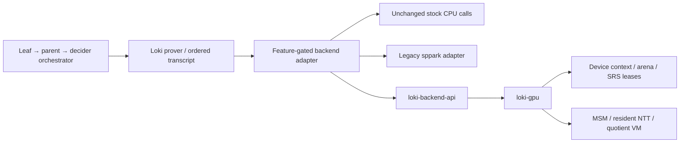

# Loki GPU backend architecture

CODE (design contract): Apache-2.0 `loki-gpu` is a separately versioned optional arithmetic backend for Loki. The first deliverable is a compileable interface and fail-closed skeleton, not an accelerated prover. The owner priority is correctness, then complete Sherlock recursion latency, then kernel speed. No backend owns randomness, Fiat–Shamir challenges, proof encoding, circuit synthesis, or verifier policy.

## Source boundary and evidence

SOURCE: review basis is Loki `877114ddc1da5508230e424ec06d55da1ba00117`, midnight-proofs 0.8.3, W10 `053577f6083b329f2bbef1f3711f92cadc92a24f` (production coefficient strategy `000b3ed`), and W13's current registry worktree. W10/W13 remain external work: this repository contains an exact patch plan, not edits to those trees. See [LOKI-PATCH-PLAN.md](LOKI-PATCH-PLAN.md) and [PROVENANCE.md](PROVENANCE.md).

SOURCE: permitted design input is the clean-room `gpu-lab/icicle-study/DESIGN.md`; later `gpu-lab/astra/{RESULTS,DESIGN-UPDATE,EXPERIMENTS}.md` qualifies its estimates. No open-icicle source, vendored derivative, H21.md, or its simulation scripts is an implementation source. Public documentation supplies ideas only. Any sppark source reuse requires exact file/revision attribution and NOTICE updates before it lands.

MEASURED (historical, shared host): W10's first coefficient-basis comparison was 233.284 → 175.256 seconds A3 prove+verify; create_proof 145.983 → 85.910 seconds, quotient 47.171 seconds, outside create_proof 89.346 seconds. This is not a measurement of this module or a complete recursion chain. X2's later weighted adapter model is 5.958–6.155 seconds, superseding the memo's older 10.5-second adapter estimate for planning. Weighting is ESTIMATE, not an independently removable cost. [TEST-PLAN.md](TEST-PLAN.md) records provenance and promotion gates.

ESTIMATE: eliminating all 85.910 seconds of create_proof in that historical sample leaves 89.346 seconds and gives at most 1.962× wider-window speedup. The design therefore profiles all leaf, parent, and decider setup/prove/verification costs and integrates W12's external cache work without claiming to implement it. No 10× recursion promise follows from MSM or NTT timings.

## Module boundaries

| Module | Responsibility | Excluded responsibility |
|---|---|---|
| `loki-backend-api` | CODE: CUDA-neutral typed requests, capabilities, errors, resident/context handles, blocking completion and SRS contracts | Curve transmutation, GPU discovery, transcript/RNG access, runtime selection |
| Loki adapter, proposed `src/backend/` | CODE: stock CPU implementation, existing sppark adapter, concrete midnight-curves conversion, feature selection, checked fallback, request ordering | New CUDA algorithms |
| `loki-gpu/src/{lib,ffi}.rs` | CODE: capability advertisement, safe Rust boundary, versioned C ABI, explicit status conversion | Silently claiming unsupported operations completed |
| `loki-gpu/src/{runtime,srs}.rs` | CODE: context/generation ownership, checked allocation, completion lifetime, exact validated SRS reuse, bounded resources | Circuit or proof identity decisions |
| `loki-gpu/src/{msm,ntt,quotient}.rs` + `cuda/` | CODE: one operation family per module; independent kernels over validated data | Transcript mutation, changed lookup order, altered circuit relations |
| Recursion orchestrator | CODE: dependency DAG, proof/VK/SRS binding, admission and whole-chain timing | Skipping child verification or terminal residue checks |
| Lean backend modules | CODE: abstract call/fallback contracts and arithmetic composition with stock reference | Claiming Rust/FFI/CUDA code is machine-verified |

CODE: the default Loki Cargo feature list remains stock; optional API/backend dependencies do not enable BLST thread changes, deterministic map changes, CPU budget changes, profiling, or CUDA transitively. P1 first audits pre-existing drift: main `src/plonk/lookup/prover.rs:427-430` unconditionally sorts leftover keys unlike stock. Restore the stock default loop and gate the deterministic variant before claiming default equivalence. With the seam disabled, audited stock branches then remain textually unchanged. A feature-enabled CPU backend calls the same stock algorithms with the same input slicing, RNG, thread and transcript behavior. Feature selection and exact call sites are normative in [LOKI-PATCH-PLAN.md](LOKI-PATCH-PLAN.md); no configuration silently selects a second backend or silently falls back in GPU-required testing mode.

CODE: API abstractions describe semantic operations rather than vendor kernel launches. Curve support is generic in Rust types, while the initial native implementation supports only Loki's BLS12-381 G1 and scalar field (`midnight_curves::Fq`, despite its name). Unsupported curves are handled by the adapter's CPU path. The backend receives immutable challenge values after the original squeeze, never the transcript itself. Batch results keep request-slot order regardless of device completion order.

## Arithmetic boundary

CODE: MSM uses the effective prefix `min(scalars.len(), bases.len())`, matching stock `zip`. The adapter truncates before a backend that requires equal lengths. Empty inputs return the stock identity through the dispatcher; zero filtering, infinity, cancellation, and canonical reduced outputs are mandatory. SRS validation is on-curve and subgroup-safe before upload. Version 1 balanced MSM uses unsigned fixed-width digits over a fixed 256-bit scalar encoding, then sorting, exact bucket partitions, bounded segments and deterministic reduction. Signed recoding, low-cardinality preaggregation, and fixed-base expansion are separate measured extensions. See [MSM.md](MSM.md).

CODE: all NTT results exposed to Loki's existing domain operations are in natural order; the general API also names explicit bit-reversed layouts for independently validated future uses. Requests bind the exact stock root, size, direction, one inverse normalization, and coset generator. `coeff_to_extended` multiplies by stock ζ powers, zero-pads, then transforms; inverse performs the stock inverse and unshift. Extended-domain rotations use Euclidean `(row + rotation * 2^(K-k)) mod 2^K`. A round trip does not establish root compatibility. Reuse permitted sppark arithmetic for the first resident engine; a new butterfly implementation needs measured justification. See [NTT.md](NTT.md).

CODE: quotient compilation preserves circuit order and the complete gates → permutation sets → lookups → trash sequence, including each `acc = acc*y + term`. Register allocation may reuse dead temporaries but may not change challenge binding, rotation interpretation, or overwrite a live value. Validation rejects malformed instruction indices and unsupported resource bounds before launch. Output remains tentative until completion; division by the vanishing polynomial and inverse coset transform preserve stock normalization/truncation. Compilation correctness and register-allocation correctness remain explicit obligations. See [QUOTIENT.md](QUOTIENT.md).

## Memory and residency

CODE: a resident value carries an owning context, generation, allocation identity, element count, representation, domain/basis metadata and lifecycle. Public safe code cannot treat a device address as a host slice. Caller metadata is untrusted: every use checks backend-owned allocation identity, element type, form, length, byte count and generation; a constructed numeric ID is not a validated handle. Every operation checks context/generation compatibility; cross-device, stale or incompatible-domain requests fail before publication. No safe arbitrary bitwise casts of generic curve or field values cross the ABI.

CODE: the process device service owns long-lived streams, events, arenas and SRS leases. Checked byte accounting includes persistent bases/twiddles, live input/output, scratch, sorting temporary storage, pinned staging, and delayed frees. Reserve scratch plus tentative output before launching. Eviction touches only completed unleased entries. Current free memory is an admission observation, not a guarantee; allocation failure remains a normal error. Memory bounds, overflow checks and high-water instrumentation are part of each operation, not an afterthought.

ESTIMATE (initial policy): one heavy k19/k20 proof, a configurable conservative device budget below current available memory, and two bounded staging slots initially; grow to at most four only after measurement. A 32-GiB board is not 32 GiB available to this process. Pinned staging allocation is checked and bounded; pageable fallback is allowed with no overlap promise. Never register an arbitrary Rust Vec as pinned memory. Exact policy and resource accounting live in [RUNTIME.md](RUNTIME.md).

CODE: SRS identity means the validated ordered points and their basis/domain, length, curve and representation, plus generation of their device storage. Address-only or caller-digest-only hits are unsound. Use immutable registered data and exact equality/proven validation for reuse; hashes may accelerate lookup but do not discharge collision/immutability obligations. Coefficient-basis prefix reuse is not permission to reuse a prefix of a larger Lagrange basis as the smaller-domain basis. W13's registry is adapted after its ownership handoff, not reimplemented concurrently.

CODE: residency begins with a full extended-domain quotient pipeline. Keep host checkpoints required for recovery and upload fixed/permutation coefficient data when economical. Release gate-only buffers once their final consumer has completed. Resident output feeds dependent kernels through event dependencies; only final needed host values are downloaded. Per-sub-coset decimation is deferred until its exact layout/rotation proof and measured memory need exist.

## Async, errors, and fallback

CODE: v1 public calls block until checked completion. Upload and resident transforms return a handle only after completion; download returns a fresh complete Vec. Streams/events are private asynchronous internals, with backend-owned staging and retained resources until event retirement. No public Pending token or direct borrowed asynchronous DMA is exposed. A later async API must be leak-safe even under mem::forget; a lifetime plus Drop wait is insufficient. Submission, completion and publication remain separate internal events.

CODE: errors preserve caller-visible logical inputs, published outputs and transcript state. Internal cache contents, health flags and context generation may change to prevent stale reuse. An unrecoverable CUDA error poisons/invalidate the generation and drains or quarantines pending allocations; no allocation is freed while queued work can reach it. A caller decides whether the error permits stock CPU fallback or should terminate the proof. Backend `Unsupported` is explicit and never increments completion counters.

| Failure point | Contract and caller action |
|---|---|
| Validation/capability/admission rejection | CODE: no launch or publication; CPU fallback from unchanged host inputs if policy permits |
| Launch/copy/event failure with retained host checkpoint | CODE: discard tentative output, invalidate affected handles, restore at the operation checkpoint, then run stock CPU computation |
| Context loss with only device-resident originals | CODE: fail the proof/session; never return success or reconstruct unknown values |
| Completion success | CODE: publish one complete result and its valid generation; transcript owner consumes it in request order |
| GPU-required benchmark | CODE: any fallback/Unsupported/error fails that gate; success counters must be nonzero |

CODE: fallback does not repeat RNG draws, transcript writes, challenge squeezes, or already committed proof stages. These actions remain outside the operation transaction. Resource failure cannot be hidden by pretending that logical equality proves physical lifetime safety. [RUNTIME.md](RUNTIME.md) specifies teardown and [TEST-PLAN.md](TEST-PLAN.md) specifies injected-failure coverage.

## Recursion and shared-device scheduling

CODE: leaf → parent → decider is a dependency graph, not three independent GPU jobs. A dependent witness uses the completed child artifact and matching VK/SRS/relation identity, preserving the production driver’s existing child-verification checks. Qualification separately verifies every stage with stock; adding a second off-circuit verification to production is not an implicit backend change. Preserve the terminal inner accumulator/residue checks and the stock ledger-compatible outer proof. The module changes arithmetic placement only; circuit topology and fresh-key proposals are external Track B work.

CODE: one process-wide arbiter serializes heavy admission and coordinates legacy and new backends. If several processes use the device, obey the shared host lock protocol (heavy before GPU); never hold a GPU lock during compilation or key/setup work that does not use the device. Within a session use one lock order: admission/device service before registry/arena metadata. CPU work may overlap only for independent ready jobs within the fixed shared CPU budget. Transcript publication stays per-proof and in stock order.

ESTIMATE: initial scheduling is FIFO among ready heavy jobs with cancellation and bounded reservations; priority/fairness refinements require measured queue delay and liveness tests. Admit a second heavy proof only after actual allocation-lifetime traces and repeated complete-chain trials establish memory safety and improvement. Mixed CPU/GPU phase wall time is not GPU occupancy. Shared SRS/PK caches may survive between chain stages only with full identity binding. [RECURSION.md](RECURSION.md) specifies the orchestration boundary.

## Proof and release boundary

CODE: `Backend.lean` models transactional operation refinement and constructs the existing `Refines`/`SameOrder` bridge. `BackendMsm`, `BackendNtt`, and `BackendQuotient` connect the algorithm contracts to their stock operations and proof composition. Existing `msmDispatch_meets`, `dispatchSeqW9_eq`, `ifftW9_isInverse`, `fused_numerator_eq` remain supporting results. `loki_proof_eq_stock` concerns equal semantic inputs, randomness, thread policy and map order; the actual Rust transcript-faithfulness and FFI obligations remain explicit.

CODE: release requires no unmarked Lean obligations, no sorry in definitions, a successful project build and reviewed theorem assumptions; compiling Rust default and CUDA skeletons; then the future implementation gates in [TEST-PLAN.md](TEST-PLAN.md). A passing Lean abstract specification does not establish CUDA kernel correctness. Performance features remain opt-in until arithmetic, stock-verifier, failure-recovery, and real recursion-chain gates pass. The ordered implementation sequence is [PLAN.md](PLAN.md).
