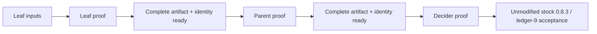

# Recursion-chain integration and scheduling

Status: proposed design contract for the assigned recursion integration slice. It adds no
proof-system or circuit change. All statements below are labelled by evidence
class; no scheduling rule establishes a proof or a speed-up.

**Evidence convention —** Unless explicitly labelled SOURCE, MEASURED,
ESTIMATE, or OPEN QUESTION, normative design prose below is **CODE (proposed
contract)**. CODE here specifies intended behavior; it does not mean the
orchestrator, GPU runtime, or kernels have been implemented or verified.

## Goal and boundary

**CODE (planned contract) —** Optimize the wall time from a ready Sherlock leaf job through its
dependent parent and decider to final acceptance by the unmodified stock
`midnight-proofs` 0.8.3 verifier. The GPU backend accelerates arithmetic inside
each ordinary `create_proof` call. It does not own proof dependencies, recurse
over proof artifacts, change transcript sequencing, or change the relation.

**CODE (planned contract) —** Keep three responsibilities separate:

| Owner | Responsibility |
|---|---|
| Moriarty/Sherlock orchestration | Validated proof-job DAG, immutable input and key lineage, readiness, retries, proof artifact verification, final publication order. |
| Loki prover | One proof's ordered transcript/RNG lifecycle and CPU reference behavior; creates a backend session for the proof and routes operations through the backend API. |
| Backend runtime | Opaque device context, streams/events, resident leases, per-operation completion, memory accounting, backend capability/error reporting. |

The scheduler depends on backend capabilities and resource estimates only. It
must not depend on CUDA stream, allocation, or kernel details. Per-proof
operation ordering remains inside Loki; inter-proof readiness and admission
remain in orchestration.

**CODE —** Sherlock parent and decider are distinct relations and keys; the
decider checks the carried residue pairing. A completed child proof and its
expected VK/instance identity are prerequisites for the dependent job. Do not
replace the decider with public accumulator fields or treat ordinary outer
PLONK verification as an inner pairing check. See
`/home/charles/repos/Moriarty-factory/wiki-llm/loki/speedups/recursion-structure.md`
and the pinned ledger-9 audit in
`/home/charles/repos/Moriarty-factory/wiki-llm/loki/gpu-lab/astra/RESULTS.md`.

## Job identity, readiness, and key reuse

**CODE (planned contract) —** Give every job a stable `JobId` and a typed role (`Leaf`,
`Parent`, `Decider`). Its immutable record binds the relation/circuit digest,
ordered parent IDs, public-instance digest, expected proof/VK identity, SRS
identity and supported degree, transcript/hash configuration, RNG seed policy,
and backend policy. A child edge becomes ready only after the child artifact is
fully written and its relation, VK, instance, and artifact identity checks
pass. This DAG readiness condition does not itself require an extra off-circuit
stock-verifier invocation. A failed or cancelled child makes descendants
unavailable. Qualification tests separately stock-verify each intermediate
proof; a production chain includes each verifier call it actually performs,
with any off-circuit child verification timed as its own stage.

**CODE (planned contract) —** Key and PK reuse is keyed by full relation and parameter
identity: circuit/relation digest, VK digest, SRS digest and degree, proof
library/version, and relevant feature/configuration identity. Distinguish PK
construction, serialization, disk reload, host-resident reuse, and device
residency in both counters and timings. Do not treat a cache hit as proof that
the relation or SRS matches.

**CODE —** Existing recursive work demonstrates that changing an upstream VK
changes downstream key identity. A new GPU arithmetic backend is Track A only
when proof bytes/semantics, VK, SRS and verifier behavior remain compatible;
this scheduling design does not authorize a relation or key migration.

## Admission and shared-device policy

**SOURCE —** The owner brief identifies the current host as a shared WSL2 system with 20 CPU cores,
90 GB RAM, RTX 5090 with 32 GB, and CUDA 13.4.3. Other agents share the GPU.
Historical A3 measurements used a shared host; they do not establish a safe
concurrent proof count.

**MEASURED —** X6 calibrated CUDA default-pool accounting on a synthetic k14
probe: 40.27 MiB live after adapter warmup, 64 MiB reserved after warming both
adapters, and per-call high-water deltas of 2.125 MiB (MSM) and 0.5 MiB (NTT).
This excludes non-pool allocations and does not establish k20 capacity or
concurrent k20 feasibility (the “X6 measured GPU allocation probe” section of
`/home/charles/repos/Moriarty-factory/wiki-llm/loki/gpu-lab/astra/RESULTS.md`).

**ESTIMATE —** X5's 23.882 GiB (75% of one reported 32,607 MiB device-memory
snapshot) is a policy cap, not measured free memory or a concurrency result.
Allocator live bytes, allocator reserved bytes, device free-memory snapshots,
and workspace estimates are different quantities. Do not infer that two
k20-sized jobs fit by doubling a k14 sample or summing unrelated estimates.

**ESTIMATE —** Start with a process-wide device arbiter, FIFO among ready heavy
jobs, and at most one active k19/k20 proving job. Waiting jobs remain as
orchestration records without a CUDA reservation or large resident lease. When
the arbiter selects a job, it requests its measured/estimated workspace using
non-blocking reservation; defer immediately when the budget cannot fit, rather
than blocking while holding a proof or completion worker. Reconcile against a
runtime snapshot containing device generation, health, budget, live bytes, and
reserved bytes. Keep resident SRS/PK buffers within the same byte budget.
Release a reservation only when all stream work using it has completed or the
context is confirmed lost and the runtime has invalidated that generation.
Enforce one CUDA owner per process; multiple independent contexts are not an
admission strategy.

**CODE (planned contract) —** Let ready CPU-only work overlap a GPU proof only when CPU
thread/RAM budgets are explicit and when it cannot block completion handling.
Do not create one full Rayon pool per proof. Do not block all runtime/completion
workers waiting for permits held by proof workers. Keep the current one-heavy
policy until repeated measurements establish memory and end-to-end benefit for
any second heavy job.

**OPEN QUESTION —** How much CPU synthesis, child validation, PK work, and
verification can overlap a k20 GPU proof without increasing the single-chain
critical path or starving the GPU completion thread? X5's mixed phase wall
times cannot answer this; instrument service intervals and queue/lock wait.

## Failure, checkpoint, and publication semantics

**CODE (planned contract) —** Preserve a host checkpoint of every input required to replay a
proof phase before dispatching an asynchronous operation. A backend error is
fallback-safe only if the backend certifies that no result was published and
the checkpoint remains intact. Replay from that checkpoint on CPU; never
continue with a partially updated device-only value.

**CODE (planned contract) —** V1 backend operations block at their public API boundary. Any
internal queued device work must retain backend-owned staging, resident leases,
and completion state until the work is retired; do not enqueue DMA from
borrowed caller memory. If internal work is abandoned or a future async handle
is dropped, the runtime must drain completion before releasing resources, or
quarantine resources and mark the generation unhealthy when completion is
uncertain. This is a backend lifetime rule; the proof scheduler must not free
operation inputs merely because its waiter was cancelled.

**CODE (planned contract) —** A failed arithmetic operation must not rewind or
repeat transcript writes, challenge squeezes, or prior proof work. If Loki
retained an operation checkpoint and the backend published no output, retry
that operation on CPU using the exact already-derived inputs and continue the
same transcript once. If the operation cannot be retried from that checkpoint,
abort the attempt. A whole-proof restart is a new attempt with a fresh proof
session and transcript; replay RNG only under a documented deterministic RNG
policy, discard the prior partial artifact, and do not implicitly replay
outside-state effects. Never mix partial GPU output with a CPU result.

**CODE (planned contract) —** Publish proof artifacts atomically only after
proving completes and local relation/VK/instance/artifact identity checks
pass. The parent may consume only the published child artifact. The decider
may consume only the published parent artifact. In qualification, independently
run the unmodified stock verifier on every stage artifact and require full
transcript consumption. In the production-shaped chain benchmark, run the
verifier calls used by production and record final terminal stock acceptance
as a separate gate from proving success.

**OPEN QUESTION —** A device context-loss path needs a tested host-side
invalidation signal and exact lease reclamation semantics. Until then, context
loss fails the active proof and invalidates all generation-tagged device
handles; it does not trigger a blind retry using stale residents.

## Timing evidence and the W12 residual

Do not use “A3 time” without naming timer scope. The difference between a wide
wrapper timer and `create_proof` is a measured boundary for one run, not a
single known cost center.

| Run / scope | Wider interval | `create_proof` | Difference outside `create_proof` |
|---|---:|---:|---:|
| **MEASURED —** H0 GPU A3, first historical sample | 233.284 s prove+verify | 145.982583427 s | 87.301416573 s |
| **MEASURED —** W10 coefficient-basis A3, first historical sample | 175.256 s prove+verify | 85.910208915 s | 89.345791085 s |

Sources: `/home/charles/repos/Moriarty-factory/wiki-llm/loki/gpu-lab/astra/RESULTS.md`,
“Provenance and H0 audit” and “W10 coefficient-basis result.” The second run
reduced `create_proof` by 60.072374512 s, while the
outside interval increased by 2.044374512 s. This is a first shared-host
comparison, not a repeated matched chain benchmark; do not combine it with B3,
A4, or other cohorts to claim a chain speed-up.

**CODE / ESTIMATE —** The external
`/home/charles/repos/Moriarty-factory/wiki-llm/loki/LOKI-DESIGN.md` attributes
78.4 s to repeated
`cost_model(rel, None)` work in a prior A3 analysis and separately lists PK
setup around 30–39 s as unmeasured. The figures are not measured on the W10
coefficient-basis snapshot and must not be added to each other or to the
89.345791085 s difference. W12's decisive output is a set of non-overlapping
timers for cost modeling, PK setup/load, child checks, local proof verification,
stock verification, and process overhead, with exact source/input identity.
Memoizing a cost model is only admissible if the exact k/degree guard and
wrong-k rejection remain enforced.

**ESTIMATE —** On the historical W10 wider interval, even a hypothetical
zero-time `create_proof` leaves 89.345791085 s, so the arithmetic ceiling from
improving only that call is 175.256 / 89.345791085 ≈ 1.96×. This is a bound for
that timer, not a prediction for the full recursion chain. The useful next
step is to measure and remove repeated external work while preserving every
check, then compare complete dependency-DAG latency.

**MEASURED —** The B3 synthetic cohort has proof-only stage sum 260.443927929
s (leaf 71.520140364, k19 parent 61.319417204, k20 decider 127.604370361).
Its three child-process intervals total 672.778552570 s, include setup/model/
witness work, and are not a top-level measured chain timer. This is not the
heterogeneous A102/A80 → A3 → A4 cohort and must not be combined with it.
See `/home/charles/repos/Moriarty-factory/wiki-llm/loki/gpu-lab/astra/RESULTS.md`,
“Recursion baseline correction” and X9.

## Benchmark plan and gates

**CODE (planned benchmark protocol) —** For each cohort, time both each ready-node execution and the
whole DAG with a monotonic wall clock. Report separately: key model/setup,
PK construction/reload, witness synthesis, each `create_proof`, child/parent
verification, stock verification, artifact publication, and wait/queue time.
Do not add nested phase timers to parent wall time or count model/setup twice.

**CODE (planned benchmark protocol) —** Every matched baseline/candidate record pins source commit and
dirty status, relation/circuit and ordered child identities, proof/VK/SRS
digests, lockfile and binary digests, features, Rust/CUDA/toolkit/driver/SM,
CPU/RAM/OS, Rayon and BLST settings, RNG policy, warm/cold state, run order,
sample count and spread, operation counters, allocation live/high-water data,
fallback/error counts, raw-log path/hash, and stock-verifier version. Keep
public scalar-distribution metadata only; do not persist witness-derived
scalars or their fingerprints in shared artifacts.

**CODE (planned benchmark protocol) —** Run isolated single-chain latency first with one heavy job;
then run separate throughput trials over independent, validated DAGs. Report
completed and stock-accepted batches per wall-clock interval, not submitted
jobs. Qualification requires stock acceptance and full transcript consumption
for every leaf, parent, and decider artifact. The production-shaped latency
run includes off-circuit intermediate verifiers only if production invokes
them, and always reports the final unmodified 0.8.3 terminal verification
separately. Report per-stage qualification verifier time separately from the
production-shaped chain timer. Each candidate must pass W2, no-fallback
dispatch assertions for GPU runs, and a repeated matched whole-chain latency
comparison. For P7
promotion, require at least a 3% reduction in matched complete-chain median
latency attributable to the new backend, with spread reported; an A3-only gain
does not meet the gate. A kernel or phase result is not a chain result.

**OPEN QUESTION —** The heterogeneous A102/A80→A3→A4 cohort still needs a
matched, provenance-complete set of all stage inputs and timers. For the B3
cohort, repeat with complete host, GPU, BLST, source/binary and verifier
provenance. Preserve separate manifests and comparisons.

## Recursion-focused order of work

1. **W12 attribution and reusable setup:** isolate the 89-second outside-proof
   interval, preserve relation/degree checks, and report cold versus warm PK
   paths separately. Do not claim savings until the matched whole-chain timer
   moves.
2. **W10 integration:** complete repeated A3 comparisons with identical
   relation, keys, SRS, input proofs and verification scope. Historical
   233.284→175.256 s is not the final baseline.
3. **Backend arithmetic:** enable residency and optimized kernels only behind
   the clean backend API; measure full chain, not just MSM/NTT. The backend
   cannot remove foreign-field circuit work or change recursion relations.
4. **DAG overlap:** permit parallel jobs only for independent ready nodes and
   only after service-time and combined-memory evidence. Never start a parent
   before all required children are accepted.
5. **Concurrency expansion:** test two-heavy admission only after actual k19
   and k20 live/high-water traces, failure/cancellation tests, and repeated
   throughput runs show a safe budget and a gain.

**OPEN QUESTION —** An end-to-end 10× target cannot follow from faster GPU
arithmetic alone. The complete cohort's leaf, parent, decider, setup, host
residual and final stock-verification costs must all be measured under one
consistent baseline and candidate. A protocol/topology change would require a
separate design and soundness review; this assigned package does not make one.
