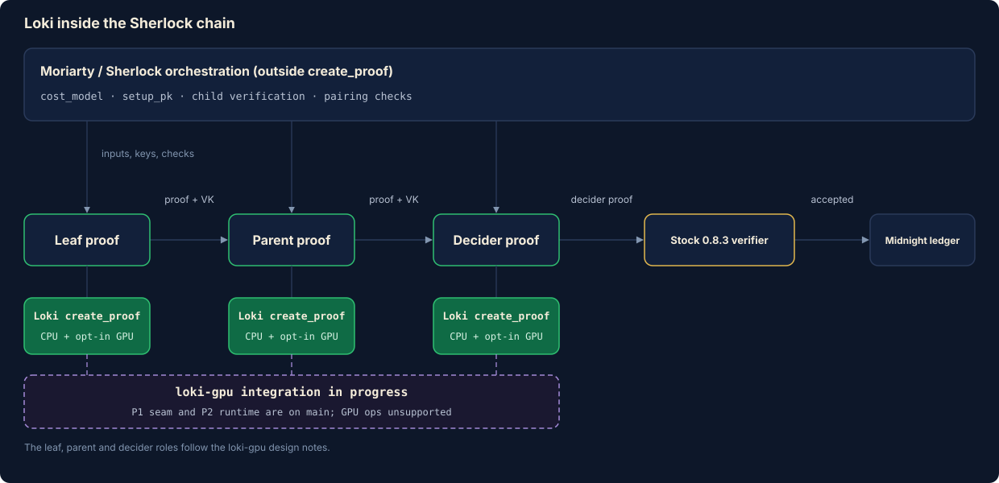
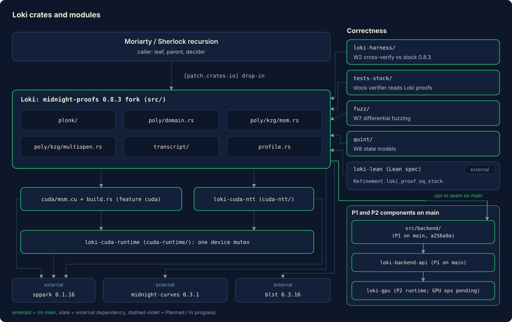
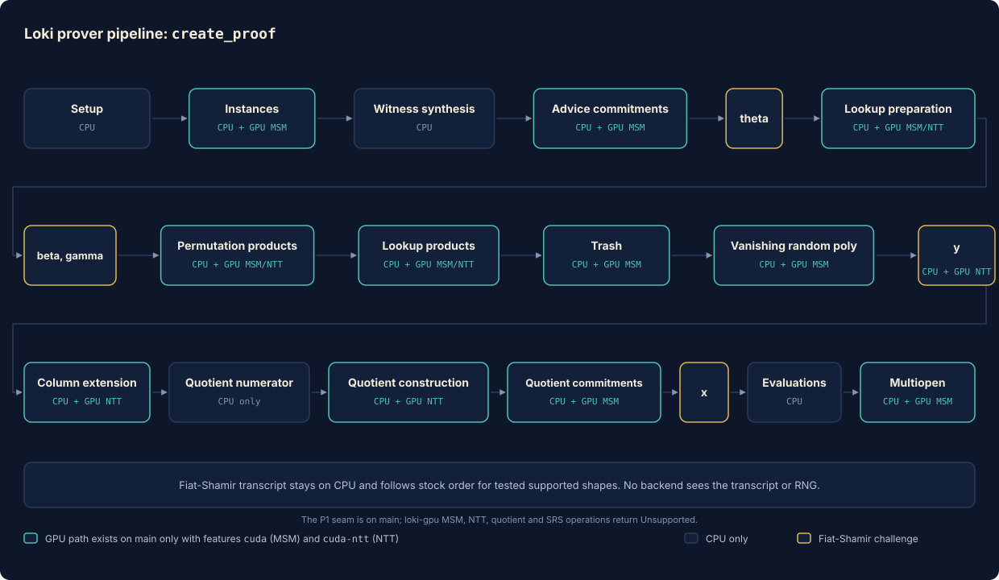
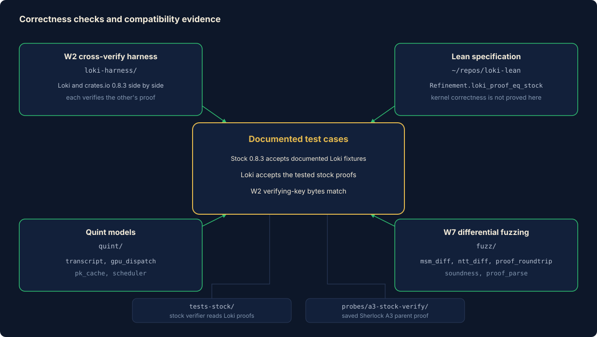
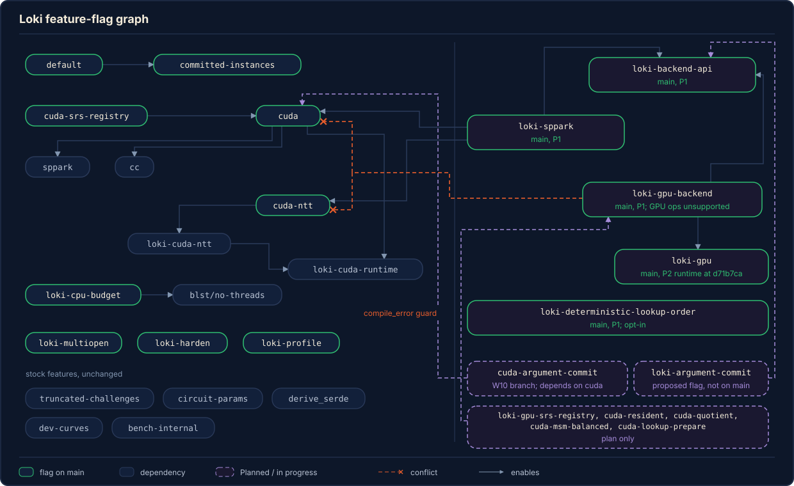

# Loki architecture

Loki is a fork of `midnight-proofs` 0.8.3. The unmodified stock 0.8.3 verifier accepts the Loki proofs covered by the documented tests. This is a compatibility result for those inputs and configurations. Proof-byte equality is separate: lookup circuits can produce different bytes, and stock has a known rejection case for mixed committed and plain instance columns across multiple proofs.

This page shows where Loki sits, how `create_proof` works, how Loki differs from stock, and how the checks and feature flags fit together. It also describes the P1 `loki-gpu` backend seam on main and the GPU work still in progress.

This page tracks Loki main at commit `a256a9a15ff18ae12a8131b86cff576787fa5e3c`. **Branch** means work not merged to main. **Planned** means design work with no implementation, or code still in progress.

Contents:

1. [Where Loki sits](#1-where-loki-sits)
2. [Crates and modules](#2-crates-and-modules)
3. [The proving pipeline](#3-the-proving-pipeline)
4. [Where Loki differs from stock](#4-where-loki-differs-from-stock)
5. [Correctness architecture](#5-correctness-architecture)
6. [Feature flags](#6-feature-flags)
7. [The loki-gpu plug-in seam (P1 on main, GPU work in progress)](#7-the-loki-gpu-plug-in-seam-p1-on-main-gpu-work-in-progress)
8. [The recursion-latency priority](#8-the-recursion-latency-priority)

## 1. Where Loki sits

Project Fenrir settles its batches on Midnight with Sherlock recursion. The proofs in that chain are made by `create_proof` from `midnight-proofs`. Loki replaces that crate through Cargo, so the code that calls it does not change:

```toml
[patch.crates-io]
midnight-proofs = { path = "../loki-proofs" }
```

The chain has three roles. A leaf proof feeds a parent proof, and the parent feeds a decider. The ledger verifies the decider proof. Each role uses the `midnight-proofs` 0.8.3 proof system over BLS12-381 with KZG commitments. W2 generated equal verifying-key bytes for its k10, k14 and k17 fixtures. Loki uses the stock SRS and proof encoding. On the default build, Loki and stock both place leftover lookup rows in `HashMap` iteration order. Separate proof generations can still produce different bytes because the map order is randomized. The opt-in `loki-deterministic-lookup-order` feature sorts those rows and can change lookup proof bytes relative to stock. The documented Loki fixtures pass the stock verifier.

<p align="center"></p>

Two boundaries matter:

- **Inside `create_proof`** is Loki's territory. Loki and its optional GPU adapters act only here.
- **Outside `create_proof`** is orchestration owned by Moriarty and Sherlock: building the cost model, setting up the proving key, verifying child proofs and running pairing checks. Loki does not own these steps. They are part of the recursion latency (see [section 8](#8-the-recursion-latency-priority)).

The recursion roles above come from the loki-gpu design (`~/repos/loki-gpu/design/RECURSION.md`) and the Loki design note (`Moriarty-factory/wiki-llm/loki/LOKI-DESIGN.md`). The diagram shows the roles used in those design notes.

## 2. Crates and modules

<p align="center"></p>

| Layer | Path | Role | Status |
|---|---|---|---|
| Loki crate | `src/` (package `midnight-proofs`, lib name `midnight_proofs`) | The prover, keygen, KZG commitment scheme, transcript and dev tools. Same public API as stock. | Main |
| `plonk/` | `src/plonk/` | `prover.rs`, `verifier.rs`, `evaluation.rs` (quotient numerator), and the four arguments: `lookup/`, `permutation/`, `trash/`, `vanishing/`. | Main |
| `poly/` | `src/poly/` | `domain.rs` (FFTs and cosets), `kzg/` (commitment scheme, `msm.rs`, `multiopen.rs`), `commitment.rs`. | Main |
| `transcript/` | `src/transcript/` | Fiat-Shamir transcript traits and the Blake2b implementations. Unchanged from stock. | Main |
| `profile.rs` | `src/profile.rs` | Phase and arithmetic counters, compiled in only with `loki-profile`. | Main |
| `loki-cuda-runtime` | `cuda-runtime/` | One process-wide mutex that serializes every sppark call. | Main |
| `loki-cuda-ntt` | `cuda-ntt/` | Narrow sppark NTT adapter for the BLS12-381 scalar field. | Main |
| CUDA MSM | `cuda/msm.cu`, `build.rs`, `src/poly/kzg/msm/cuda/` | sppark-based MSM for G1, with a resident-SRS cache. Built by `cc` only with `cuda`. | Main |
| Differential harness (W2) | `loki-harness/` | Independent workspace: Loki and crates.io `midnight-proofs =0.8.3` side by side. | Main |
| Stock-only verifiers | `tests-stock/`, `tests/stock-profile-verifier/`, `probes/a3-stock-verify/` | Registry 0.8.3 verifiers that read Loki proofs. | Main |
| Fuzzing (W7) | `fuzz/`, `fuzz/diff/` | cargo-fuzz and proptest differential targets. | Main |
| Quint models (W8) | `quint/` | Four state models. Transcript, dispatch and proving-key cache models have Rust replay tests; the scheduler model has no implementation to replay. | Main |
| Lean spec | `~/repos/loki-lean` (outside this repository) | Refinement of stock, with component contracts. | Main, external repository |
| `loki-backend-api` | `~/repos/loki-gpu/crates/loki-backend-api` | CUDA-neutral request, capability and error types. | Main integration, P1 |
| `loki-gpu` | `~/repos/loki-gpu/crates/loki-gpu` | Apache-2.0 GPU backend with the P2 transactional runtime. MSM, NTT, quotient and SRS operations remain unsupported. | P2 runtime merged at `d71b7ca`; P4 in progress |
| Loki adapter `src/backend/` | `src/backend/` | Dispatcher and stock CPU adapter behind the seam. | Main, P1 merged at `a256a9a15ff18ae12a8131b86cff576787fa5e3c` |

External dependencies that Loki relies on but does not own: `midnight-curves` 0.3.1 (field and curve types), `blst` 0.3.16 (CPU MSM), and sppark 0.1.16 (CUDA MSM and NTT kernels, Apache-2.0). Each module is explained in [`docs/modules/README.md`](modules/README.md).

## 3. The proving pipeline

`create_proof` in `src/plonk/prover.rs` calls `compute_trace`, then `finalise_proof`. The phase table follows that code. Loki keeps transcript writes and challenge squeezes on the CPU. The tested supported shapes follow the stock prover's transcript order. The known mixed committed/plain multi-proof case is an upstream exception where stock's prover and verifier order instances differently.

<p align="center"></p>

### Phase table

Names in the first column are the `loki-profile` phase names, where one exists. The last column states what can move to the GPU on `main`. Only two operations can: `msm_specific` (feature `cuda`) and `EvaluationDomain::fft` / `ifft` (feature `cuda-ntt`). Everything else is CPU, parallelized with Rayon.

| # | Phase (profile name) | What happens | Source | GPU on main |
|---|---|---|---|---|
| 0 | Setup | Hash the verifying key into the transcript. Check instance counts. | `prover.rs: compute_trace` | CPU |
| 1 | Instances | Write instance values. Committed instances (feature `committed-instances`, on by default) get a `commit_lagrange` commitment. | `prover.rs: compute_instances` | MSM |
| 2 | Witness synthesis (`witness_synthesis.phase_N`) | Run the circuit once per phase through a `WitnessCollection`. Batch-invert rational advice cells. | `prover.rs: parse_advices`, `poly/mod.rs: batch_invert_rational`, `circuit/floor_planner/` | CPU |
| 3 | Advice commitments (`advice_commitments`) | Commit each advice column, write the commitments, then squeeze that phase's challenges. | `prover.rs: parse_advices` | MSM |
| 4 | Challenge θ | Squeeze θ, which compresses lookup expressions. | `prover.rs: compute_trace` | CPU |
| 5 | Lookup preparation (`lookup_prepare`) | Compress input and table, sort, build the permuted columns A' and S', commit both, write both. | `plonk/lookup/prover.rs: commit_permuted`, `permute_expression_pair` | MSM, NTT |
| 6 | Challenges β, γ | Squeeze both. | `prover.rs: compute_trace` | CPU |
| 7 | Permutation products (`permutation_products`) | Build the grand-product polynomial per permutation set, commit, write. | `plonk/permutation/prover.rs: commit` | MSM, NTT |
| 8 | Lookup products (`lookup_products`) | Build the lookup grand product Z, commit, write. | `plonk/lookup/prover.rs: commit_product` | MSM, NTT |
| 9 | Trash (`trash`) | Squeeze the trash challenge. Compress and commit the additive-selector expressions, write. | `plonk/trash/prover.rs: commit` | MSM |
| 10 | Vanishing random polynomial | Commit the blinding polynomial for h(X), write. | `plonk/vanishing/prover.rs: commit` | MSM |
| 11 | Challenge y | Squeeze y, which combines all constraints. Convert advice to coefficient form. | `prover.rs: compute_trace` | NTT |
| 12 | Column extension (`compute_nu_poly`) | Move advice and instance columns to the extended coset (`coeff_to_extended`). | `prover.rs: compute_nu_poly`, `poly/domain.rs` | NTT |
| 13 | Quotient numerator (`quotient_evaluation`) | Evaluate gates, permutation, lookup and trash terms over the extended domain and combine them with powers of y. | `plonk/evaluation.rs: evaluate_numerator` | CPU only |
| 14 | Quotient construction (`quotient_construct`) | Divide by the vanishing polynomial, return to coefficients (`extended_to_coeff`), truncate, split into pieces, blind. | `plonk/vanishing/prover.rs: construct` | NTT |
| 15 | Quotient commitments (`quotient_commitment`) | Commit each h piece, write. | `plonk/vanishing/prover.rs: construct` | MSM |
| 16 | Challenge x and evaluations (`evaluations`) | Squeeze x. Evaluate and write every opened polynomial. | `prover.rs: write_evals_to_transcript`, each argument's `evaluate` | CPU |
| 17 | Multiopen (`multiopen`, nested `kzg_multiopen`) | Build queries. Squeeze x1, x2. Combine polynomials, write the commitment to f, squeeze x3, write evaluations, squeeze x4, write the commitment to π. | `prover.rs: compute_queries`, `poly/kzg/mod.rs: multi_open` | MSM |

### Notes on the phases

Synthesis runs the user's circuit and fills advice columns. It is CPU work and depends on the circuit. The transcript is generic over a `TranscriptHash` (`src/transcript/mod.rs`). The Blake2b state hash absorbs a prover message with prefix `1` and squeezes a challenge with prefix `0`; `Blake2b256` is a second implementation (`src/transcript/implementors.rs`). The Sherlock A3 parent proof uses a Poseidon transcript (`probes/a3-stock-verify/README.md`). Transcript code is unchanged from stock. No backend sees the transcript or the random number generator.

All commitments go through `KZGCommitmentScheme::commit` or `commit_lagrange` (`src/poly/kzg/mod.rs`). Both call `msm_specific` in `src/poly/kzg/msm.rs`. This is where the `cuda` feature takes over. With the feature off, `msm_specific` calls `msm_cpu`, which has the stock body: zero filtering, then one blst Pippenger call for G1.

Lookup preparation builds permuted columns by sorting the compressed input and placing leftover table values. The map iteration order determines which valid permutation is chosen. Because that order is randomized, lookup proofs can differ byte-for-byte between stock runs (see [section 4](#4-where-loki-differs-from-stock)).

Permutation and lookup products each need a batch inversion and a prefix product over usable rows. Loki parallelizes both (`utils/arithmetic.rs: batch_invert_parallel`, `prefix_product`) with the same results and random-number draws.

The quotient numerator is the largest phase in the A3 profile (72.9 s of a 292.7 s window, `LOKI-DESIGN.md`; it was 18.6% of the k16 synthetic proof). `evaluate_numerator` walks a compiled graph of gate, permutation, lookup and trash terms across the extended domain, accumulating with `acc = acc * y + term`. The extended domain is a coset of size `2^extended_k`. Column extension multiplies coefficient i by `ζ^(i mod 3)` and runs an FFT (`coeff_to_extended`). Rotations are taken modulo the extended size. The GPU NTT accelerates transforms in this phase, but numerator evaluation has no GPU path on main.

Multiopen combines queried polynomials per point set with powers of x1, divides out the points, folds with powers of x2 into f, commits f, opens at x3, folds the evaluations with powers of x4, and commits the final quotient π. The two commitments are MSMs. The surrounding polynomial arithmetic runs on the CPU; `loki-multiopen` parallelizes that work.

### What the GPU does today

| Operation | Feature | Entry | Condition | On error |
|---|---|---|---|---|
| G1 MSM (sppark, resident SRS) | `cuda` | `msm_specific` → `cuda::try_msm` | Type is `midnight_curves::G1Affine`. `min(coeffs.len(), bases.len())` at least `LOKI_GPU_MSM_MIN` (default 16384). | Log once, disable the GPU MSM for the process, finish on CPU. |
| Scalar-field NTT (sppark) | `cuda-ntt` | `EvaluationDomain::fft` / `ifft` → `gpu_fft` | Type is `midnight_curves::Fq`. Length from `2^10` to `2^28`. `LOKI_NTT_CPU` unset. | Log once, run `best_fft` on CPU. |

Both adapters take the same `loki_cuda_runtime::lock()` mutex. The device lock is taken before the MSM cache lock. Details are in [`docs/GPU.md`](GPU.md) and `LOKI-GPU-MSM.md`, `LOKI-GPU-NTT.md`, `LOKI-HARDEN.md`.

Limits stated with the results:

- The GPU MSM slows down on repeated scalars. A warm k18 synthetic took about 2,419 ms with wide repeated scalars, against about 25 ms with random scalars (`Moriarty-factory/wiki-llm/lessons/prover-performance.md`). The W10 profile records the k18 full-width-repeat median at 87.1 times random (`loki-wt/w10-gpu-quotient/LOKI-A3-PROFILE.md`).
- Faster kernels barely moved the end-to-end time of a real Sherlock parent. The time sits in CPU phases and in work outside `create_proof` (see [section 8](#8-the-recursion-latency-priority)).

## 4. Where Loki differs from stock

Loki changes fall into three groups: optional changes, unconditional changes that preserve outputs, and lookup placement, which can change proof bytes.

### 4.1 Feature-gated changes (off by default)

Each of these is absent from a default build. Flag names are from `Cargo.toml`.

| Flag | What changes | Where | Why |
|---|---|---|---|
| `cuda` | G1 MSM runs on the GPU above a length threshold. Resident-SRS cache with curve and subgroup validation on upload. | `src/poly/kzg/msm.rs`, `msm/cuda*`, `cuda/msm.cu`, `build.rs` | MSM is the largest group of commitments. |
| `cuda-srs-registry` (implies `cuda`) | Replaces the two-slot SRS cache with a byte-budgeted registry that reuses an exact validated prefix. Budget: `LOKI_GPU_SRS_BUDGET_BYTES`, default 4,294,967,296. | `src/poly/kzg/msm/cuda/backend.rs` | Uploading and validating a full SRS dominated small prefix MSMs. |
| `cuda-ntt` | Scalar-field FFT and inverse FFT run on the GPU. Errors fall back to the CPU FFT. | `src/poly/domain.rs`, `cuda-ntt/` | One k16 proof makes 17 FFT and inverse FFT calls (`LOKI-PROFILE.md`). |
| `loki-multiopen` | Clone-free, ordered parallel polynomial work in `multi_open`, with root-product division. The verifier path and the transcript writes are unchanged. | `src/poly/kzg/multiopen.rs`, `kzg/utils.rs`, `kzg/mod.rs` | Multiopen was about 16 to 22% of a CPU proof (`LOKI-MULTIOPEN.md`). |
| `loki-cpu-budget` (implies `blst/no-threads`) | Serial blst, with MSM chunks scheduled on the active Rayon pool, so Rayon and blst share one worker budget. | `src/poly/kzg/msm.rs` | Two separate thread pools oversubscribed the host (`LOKI-CPU.md`). |
| `loki-harden` | Checked domain construction (`EvaluationDomain::try_new`) in keygen and key reading. Widened rotation arithmetic (`i128`). | `src/poly/domain.rs`, `plonk/keygen.rs`, `plonk/mod.rs`, `plonk/evaluation.rs` | Stock truncates a `2^32` size or degree to zero and panics or misindexes (`LOKI-HARDEN.md`). |
| `loki-profile` | Phase timers, MSM and FFT counters, JSONL output (`LOKI_PROFILE`). No effect on values. | `src/profile.rs` and hooks | Measure before optimizing. |

`committed-instances` is on by default in stock too. `truncated-challenges` and `circuit-params` are stock features and are not Loki changes.

### 4.2 Unconditional changes that keep values, randomness and order

These W3 CPU changes ship in every Loki build. The arithmetic changes preserve outputs and random-number draws. Lookup placement is described separately in section 4.3 because its valid permutation can change the proof bytes.

| Change | Where | Equivalence argument |
|---|---|---|
| `batch_invert_parallel` and `prefix_product` replace serial inversion and scan in the lookup and permutation grand products. The product column is built over the usable rows, then the last value and the random blinding rows are appended. | `utils/arithmetic.rs`, `plonk/lookup/prover.rs`, `plonk/permutation/prover.rs` | Exact field arithmetic for any chunking. Zero denominators stay zero. Lean: `montBatchInvert_eq`, `batchInvertParallel_eq`, `chunkedScan_eq`, `product_column_eq` (`~/repos/loki-lean/SPEC.md`). |
| `batch_invert_rational` skips denominators equal to one and inverts the rest in parallel. | `poly/mod.rs` | Same values. It branches on witness data (`denominator == ONE`), which changes timing but not output. The P1 audit records this behavior against source snapshot `a868ee0` (`LOKI-P1-SEAM.md`); P1 has since merged to Loki main at `a256a9a15ff18ae12a8131b86cff576787fa5e3c`. |
| `permuted_input_expression.par_sort()` replaces `sort()`. | `plonk/lookup/prover.rs` | Both are stable sorts under a total order. |
| `msm_specific` delegates to `msm_cpu`, whose body is the stock `msm_specific`. | `poly/kzg/msm.rs` | Same code, one level deeper. |
| `fft` / `ifft` helpers take `&mut Vec` so the GPU arm can replace the buffer. | `poly/domain.rs` | With `cuda-ntt` and `loki-profile` off, the body is `best_fft` plus the divisor. |
| `create_domain` returns `Result`. | `plonk/keygen.rs` | Crate-private. The default branch still calls `EvaluationDomain::new`. |
| `blst` is a direct dependency, `build.rs` exists. | `Cargo.toml`, `build.rs` | The resolved default dependency set equals stock. `main()` is empty without `cuda`. |

### 4.3 Opt-in lookup placement order

On the default build, `permute_expression_pair` iterates leftover table keys through `HashMap`, as stock does. The map's randomized iteration order can produce different lookup proof bytes between processes. With `loki-deterministic-lookup-order`, Loki sorts the keys before placing them (`src/plonk/lookup/prover.rs`, the `leftovers.sort_unstable_by` loop). This opt-in feature can choose a different valid lookup permutation and produce proof bytes that differ from stock.

Consequences, all measured or stated in the notes:

- Stock and default Loki can produce different lookup proof bytes across processes because `HashMap` order changes. The harness reports lookup byte differences as diagnostic and checks byte equality on a no-lookup control (`loki-harness/README.md`; `LOKI-HARDEN.md`: "documented lookup-order differences remain").
- The `loki-deterministic-lookup-order` feature selects sorted leftover keys and can change proof bytes. P1 merged this feature into Loki main at `a256a9a15ff18ae12a8131b86cff576787fa5e3c`; the feature remains opt-in.

The Lean model allows any valid lookup placement (`Refinement.loki_lookup_valid`, `loki_lookup_order_free`). `loki_proof_eq_stock` compares runs with the same map order (`SameOrder`), input, randomness and thread count.

## 5. Correctness architecture

The documented compatibility evidence comes from the W2 cross-verification harness, separate stock-verifier fixtures, differential fuzzing, and model checks. These cover specific circuits, inputs and configurations. They do not establish acceptance for every API shape or byte equality with stock in every run.

<p align="center"></p>

### 5.1 W2 cross-verify harness (`loki-harness/`)

An independent Cargo workspace depends on two packages named `midnight-proofs`: the parent Loki path package, and crates.io `=0.8.3` under the rename `stock`. It must not patch crates.io, because that would destroy the oracle (`loki-harness/Cargo.toml`, `README.md`).

The gate (`loki-harness/src/lib.rs`, `src/backend.rs`, `run.sh`) does the following at k10, k14 and k17:

- Both backends run keygen independently. Verifying-key bytes must be identical.
- SRS bytes round-trip in both directions.
- Each backend verifies the other's proof, and its own.
- Wrong public inputs, empty proofs and proofs with an appended byte must be rejected by both verifiers.
- Four mutation controls (gate, permutation, lookup, phase) must fail in `MockProver`.
- A no-lookup control must produce byte-identical proofs under fixed seeds and one Rayon worker.

The recorded run (2026-10-24) passed, with 72.78 s wall for `run.sh`. It is one warm sample and shows no speed difference. The harness covers k10, k14 and k17 with crates.io 0.8.3; k20 is ignored by default, and the recorded run does not cover 0.8.1. Those two cases remain open under T04 in `TODO.md`. `loki-harness/Cargo.toml` forwards `cuda = ["loki/cuda"]`, so `--features cuda` selects the GPU MSM. The README paragraph that calls it a "placeholder" is stale.

Smaller stock-only checks sit beside it: `tests-stock/` (registry 0.8.3 verifies the CPU fixture and rejects corruption), `tests/stock-profile-verifier/`, `tests/ntt-stock/` (k17 NTT proofs) and `probes/a3-stock-verify/` (the saved Sherlock A3 parent proof, with lane, byte and truncation rejection).

### 5.2 Lean specification (`~/repos/loki-lean`)

Lean's `Refinement.loki_proof_eq_stock` theorem compares the outputs of one abstract `prove` program for stock and a backend satisfying `Refines` and `SameOrder` (`LokiLean/Refinement.lean`). It assumes equal parameters, proving key, circuit and witness, equal randomness and thread count, and the same lookup map order. The resulting event and proof-byte equality is conditional on those assumptions. The theorem does not verify the deployed Rust or CUDA implementation.

Under those contracts, `Refines.eq_stock` proves that the modeled backend is extensionally equal to `StockBackend` (`LokiLean/Refinement.lean:853-856`). This is a statement about the abstract backend model.

`Refinement.lokiMainBackend_refines` proves component contracts for an abstract backend, with GPU MSM and NTT functions supplied as parameters. Its quotient function remains free. The separate `OBLIGATION(quot-inputs)` links quotient inputs to the proof pipeline. The `stock-trace-faithful` and `keygen-deterministic` obligations also remain open. The Lean model does not wire the stateful W9 MSM cache and failure state into the assembled backend; W9 checks the MSM dispatch behavior per call. See the obligation table in `SPEC.md` and `Refinement.lean`.

Component modules in the base `~/repos/loki-lean` tree: `Field`, `Ntt`, `Msm`, `Plonk`, `Transcript`, `Multiopen`, `Fusion`, `Pipeline`, `GpuSystem`, `Refinement`. Its `SPEC.md` states that no `sorry` remains in `LokiLean/`. The separate `~/repos/loki-lean-wt/gpu-spec` worktree adds GPU backend contracts; `BackendMsm.lean:282` and `BackendQuotient.lean:182` contain two `sorry` placeholders. The base tree still lists open modeling assumptions, including `stock-trace-faithful` and `keygen-deterministic`.

Limits that the spec states about itself:

- It models mathematical values and event order. It does not establish CUDA layout or timing. Kernel correctness remains a component obligation, with empirical checks from fuzzing and equality tests.
- It was last synced to Loki commit `877114d`. Loki main is now `a256a9a15ff18ae12a8131b86cff576787fa5e3c`; W7, W13, X2 and P1 have merged since the sync. The spec's `scripts/drift.py` (in `loki-lean`) lists spec items whose cited Rust changed; run it after each merge.
- The GPU backend contracts (`Backend.lean`, `BackendMsm.lean`, `BackendNtt.lean`, `BackendQuotient.lean`) exist only on the `gpu-spec` worktree (`~/repos/loki-lean-wt/gpu-spec`). They cover the **Planned** backend.

### 5.3 Quint models (`quint/`)

Four bounded models cover stateful parts of the design. The transcript, GPU dispatch and proving-key cache models have Rust replay tests in `quint/mbt/` that drive existing code. The scheduler model describes a proposal and has no implementation to replay (`quint/mbt/README.md:63`):

| Model | What it checks |
|---|---|
| `transcript.qnt` | The Fiat-Shamir event sequence is the stock prefix order. Each squeeze binds everything absorbed before it. Computation may finish out of order within a phase; publication stays ordered. |
| `gpu_dispatch.qnt` | Threshold routing, pointer reuse, resident contents, GPU errors with CPU fallback. The result equals the CPU oracle. |
| `pk_cache.qnt` | Proving-key cache identity is the full `(circuit hash, k, params hash)`. At most one build. No use before publication. |
| `scheduler.qnt` | A proposal for the tree scheduler: budget and slot limits, one admission per job, checkpoint progress. |

All four models passed 10,000-sample safety runs with their reachability witnesses (`LOKI-QUINT.md`, `quint/check.py`). These are bounded sampled safety checks. They do not prove GPU arithmetic or scheduler liveness. The same note records a stock defect: for mixed committed and plain instance columns with several proofs, stock's own verifier rejects (`quint/instance-order-counterexample.itf.json`).

### 5.4 W7 differential fuzzing (`fuzz/`)

Five targets compare Loki with unmodified stock 0.8.3 and, where cheap, with a naive definition (`LOKI-FUZZ.md`):

| Target | Check |
|---|---|
| `msm_diff` | Loki MSM equals stock MSM equals the naive sum, across window and chunk boundaries and degenerate inputs. With `cuda`, a tracing layer turns the silent GPU-to-CPU fallback into a failure. |
| `ntt_diff` | Each domain conversion equals stock and a naive DFT. This pins the root, the coset generator and the single `1/n`. |
| `proof_roundtrip` | Random circuits: identical VK bytes, mutual proof acceptance, full transcript consumption. |
| `soundness` | For a witness mutation, Loki and stock `MockProver` determine whether the witness is invalid. Both verifiers must reject proofs of a mutation that `MockProver` rejects; if it accepts the witness, both verifiers are expected to accept. Flipped or truncated proof bytes, changed or extra public inputs, and changed VK cases are also checked. Acceptance of an invalid case is release-blocking. |
| `proof_parse` | Arbitrary bytes into the VK, SRS and proof readers: Loki and stock must agree on accept, reject and panic. |

`fuzz/quick.sh` is the stable-toolchain gate. The 30-minute libFuzzer runs and GPU slices need nightly and the GPU runner. The `proof_roundtrip` and `soundness` campaigns stayed at 4 to 6 byte inputs, so they were close to seeded random testing rather than structured-byte mutation (`LOKI-FUZZ.md`).

### 5.5 What is not covered

- GPU kernels have equality and fuzz coverage, not a machine-checked proof.
- Most measurements are single samples on a shared host.
- The Lean spec trails `main` by three merges (see above).
- Rust 1.76 and 32-bit builds have not been executed (`LOKI-HARDEN.md`).

## 6. Feature flags

<p align="center"></p>

On `main` (`Cargo.toml`):

```toml
default = ["committed-instances"]
cuda = ["dep:sppark", "dep:cc", "dep:loki-cuda-runtime"]
cuda-ntt = ["dep:loki-cuda-ntt"]
cuda-srs-registry = ["cuda"]
loki-cpu-budget = ["blst/no-threads"]
loki-multiopen = []
loki-harden = []
loki-profile = []
loki-backend-api = ["dep:loki-backend-api"]
loki-sppark = ["loki-backend-api", "cuda", "cuda-ntt"]
loki-gpu-backend = ["loki-backend-api", "dep:loki-gpu", "loki-gpu/cuda"]
loki-deterministic-lookup-order = []
```

Stock features (`committed-instances`, `truncated-challenges`, `circuit-params`, `derive_serde`, `dev-curves`, `bench-internal`) are unchanged. The default set matches stock. No Loki feature is on by default.

Rules that keep the graph safe:

- `cuda-ntt` is independent of `cuda`. `loki-cuda-ntt` depends on `loki-cuda-runtime`, so both adapters share one mutex.
- `loki-cpu-budget` owns the blst thread change. No GPU flag turns it on.
- Arithmetic backend features preserve transcript order, random-number draws and proof encoding. The opt-in `loki-deterministic-lookup-order` changes leftover placement and can change lookup proof bytes.

P1 added the plug-in seam to Loki main. P2 added the transactional runtime and versioned C ABI to loki-gpu main. GPU arithmetic integration remains in progress. The table includes current P1 flags and features that remain planned:

| Flag | Meaning | State |
|---|---|---|
| `loki-backend-api` | Enables the dispatcher and the stock CPU adapter. | Main, P1 |
| `loki-sppark` | `loki-backend-api` plus `cuda` plus `cuda-ntt`: the legacy sppark route. | Main, P1 |
| `loki-gpu-backend` | `loki-backend-api`, the `loki-gpu` crate, and `loki-gpu/cuda`. GPU arithmetic operations currently return `Unsupported`. | Main, P1 seam; P2 runtime in loki-gpu main |
| `loki-deterministic-lookup-order` | The sorted leftover placement, opt-in. | Main, P1 |
| `loki-argument-commit` | Proposed portable coefficient-basis argument commitments, without CUDA. | Plan only; absent from the current W10 branch |
| `cuda-argument-commit` | Enables `cuda`; the current W10 branch declares `cuda-argument-commit = ["cuda"]`. | Branch `loki/w10-gpu-quotient`, not on main |
| `loki-gpu-srs-registry`, `cuda-resident`, `cuda-quotient`, `cuda-msm-balanced`, `cuda-lookup-prepare` | New-backend registry, resident transforms, quotient pipeline, balanced MSM, lookup preparation. | Plan only |

`loki-gpu-backend` cannot be combined with `cuda` or `cuda-ntt`, directly or through `loki-sppark`. `src/lib.rs` enforces this with a compile-time guard so that two device runtimes are never selected (`LOKI-PATCH-PLAN.md`, "Cargo feature boundary").

## 7. The loki-gpu plug-in seam (P1 on main, GPU work in progress)

The design sources are `~/repos/loki-gpu/design/ARCHITECTURE.md`, `LOKI-PATCH-PLAN.md` and `PLAN.md`. P1 is merged into Loki main, and P2's transactional runtime and versioned C ABI are in loki-gpu main at `d71b7ca`. The MSM, NTT, quotient and SRS operations still return `Unsupported`; P4 is in progress. The user-facing description is in [`docs/GPU.md`](GPU.md).

The goal is an Apache-2.0, clean-room backend that plugs into Loki behind opt-in features, keeps stock behavior with the features off, and reduces the latency of the whole Sherlock recursion chain at k19 to k20. The owner's priority order is correctness, then complete recursion latency, then kernel speed.

The design divides ownership this way:

| Owner | Does | Never does |
|---|---|---|
| Loki | Synthesis, randomness, Fiat-Shamir challenges, proof encoding, transcript writes, request order, CPU fallback. | |
| `loki-backend-api` | Typed requests, capabilities, errors, resident handles, SRS contracts. | Curve conversion, GPU discovery, backend selection. |
| `loki-gpu` | Validated execution of MSM, NTT and quotient work; device context, arenas, SRS leases. | Touch the transcript or the RNG. |
| Orchestrator (Moriarty) | The leaf, parent and decider dependency graph, admission, whole-chain timing. | |

P1 implements the MSM and transform hooks below on main. The quotient program, backend SRS residency and argument commitments remain planned follow-up work:

1. `msm_specific` in `src/poly/kzg/msm.rs`: with `loki-backend-api`, dispatch calls the selected `Backend::msm` after the existing `cuda` arm. The stock CPU adapter retains the `min(scalars.len(), bases.len())` zip rule.
2. The `EvaluationDomain` transforms in `src/poly/domain.rs`: `fft`, `ifft` and the coset operations dispatch through the backend when enabled. The CPU path preserves the stock body; an accelerated transform returns a fresh buffer, and inverse normalization is applied exactly once.
3. `compute_nu_poly` and `Evaluator::evaluate_numerator`: P5 will compile the ordered quotient graph into a `QuotientProgram`. Gates, permutation, lookups and trash terms keep their order, including each `acc = acc * y + term`.
4. SRS residency in `src/poly/kzg/msm/cuda/backend.rs`: the W13 registry becomes validated, byte-budgeted residency keyed by basis, point count, curve ABI, device generation and verified content identity. Address-only hits are rejected.
5. Argument commitments (W10's follow-up): coefficient-basis commitment when `params.max_k() == domain.k()`. This depends on W10 merging first.

The design error rule preserves the caller's inputs and publishes no output after an API error. Loki may recompute on the CPU only while it holds every host input. If only a device copy remains and the context is lost, the proof fails. Fallback never repeats an RNG draw, a transcript write or a squeeze. In a GPU-required benchmark, any fallback fails the gate.

The current implementation includes:

| Item | State |
|---|---|
| `loki-backend-api` types (`MsmBackend`, `TransformBackend`, `ResidentBackend`, `QuotientBackend`, `SrsRegistry`, `Backend`) | P1 interface on main |
| `loki-gpu` modules `msm`, `ntt`, `quotient`, `runtime`, `srs`, `ffi` | P2 runtime and versioned C ABI on main; MSM, NTT, quotient and SRS operations return `Unsupported` |
| Loki seam `src/backend/{mod,cpu,dispatch}.rs` | P1 merged to main at `a256a9a15ff18ae12a8131b86cff576787fa5e3c` |
| Lean backend contracts | `gpu-spec` worktree, not on main |
| GPU kernels for the new backend | P4 in progress; no proof arithmetic is supported yet |

Open plan items include the native quotient program interpreter (P5), a balanced MSM (P6, conditional), the complete-chain scheduler (P7), and lookup preparation (P8, conditional).

## 8. The recursion-latency priority

The owner's main speed goal is the latency of the whole recursion chain, from a ready leaf job to the stock verifier accepting the decider. Kernel speed is the last priority, after correctness.

What the measurements say:

On the real k20 Sherlock parent (A3), GPU argument commitments (W10, Branch) reduced prove plus verify from 294.285 s to 237.808 s, or 19.19%, in one clean matched sample each. `create_proof` fell from 206.23 s to 143.83 s. Both runs completed 45 MSMs and 79 NTTs with no fallback. Source: `loki-wt/w10-gpu-quotient/LOKI-A3-PROFILE.md`. The `cuda-argument-commit` feature has not merged to main.

For the exact-prefix SRS registry (W13, Main), median k17 preparation fell from 7,460.926 ms to 968.290 ms, and k17 `create_proof` fell from 8,968.678 ms to 2,479.872 ms on a synthetic fixture (`LOKI-SRS-REGISTRY.md`). This was not a chain measurement.

Root-product multiopen (W11, Main, `loki-multiopen`) reduced the multiopen phase on a k17 fixture by 10.0% at four threads and 19.5% at 20 threads. End to end, the reductions were 0.7% and 3.9% (`LOKI-MULTIOPEN.md`). Those end-to-end ranges overlap.

An earlier GPU-MSM run reduced `create_proof` from 175.4 s to 162.4 s while other work was running (`LOKI-DESIGN.md`). The largest phase, quotient evaluation, stayed on the CPU.

Moriarty's parent step builds a cost model (`optimal_k` over k = 9 to 20, timed at 78.4 s alone), rebuilds the proving key per proof, and verifies child and parent proofs. These steps are outside Loki's GPU path. The Loki design note estimates 117.3 s of a 292.7 s window for this work, but that run overlapped another job. The clean W10 runs show about 94 s outside `create_proof` (237.808 s minus 143.825 s) in the optimized GPU case.

Consequences for the design:

- Work follows the profile. `loki-profile` records wall time per phase, and `LOKI-PROFILE.md` defines the phases.
- The backend plan treats leaf, parent and decider as a dependency graph, not three independent GPU jobs. Proof, VK and SRS identities bind each edge. Child verification is not skipped.
- Admission is one heavy proof at a time until measured memory traces allow more. A second heavy proof is admitted only after allocation-lifetime traces and repeated complete-chain trials show it is safe and faster.
- A proving-key and SRS cache across chain stages (design item W12) is outside Loki's arithmetic. It is a candidate saving of 30 to 39 s from the second proof on, an estimate in the design note.
- No claim of a large factor follows from MSM or NTT timings. The design note bounds Track A (same keys) at roughly 3x on A3 after all listed steps, as an estimate. Larger gains need new keys (Track B), which requires an owner decision.

## Source notes

| Note | Topic |
|---|---|
| `LOKI-CPU.md` | W3 CPU changes and measurements |
| `LOKI-PROFILE.md` | W1 phase profile |
| `LOKI-GPU-MSM.md` | W4 GPU MSM |
| `LOKI-GPU-NTT.md` | W5 GPU NTT |
| `LOKI-HARDEN.md` | W9 hardening and fallback |
| `LOKI-MULTIOPEN.md` | W11 multiopen |
| `LOKI-SRS-REGISTRY.md` | W13 SRS registry |
| `LOKI-QUINT.md` | W8 Quint models |
| `LOKI-FUZZ.md` | W7 fuzzing |
| `LOKI-DONE.md` | Definition of done, gates G1 to G9 |
| `CHANGELOG.md` | Upstream changelog |
