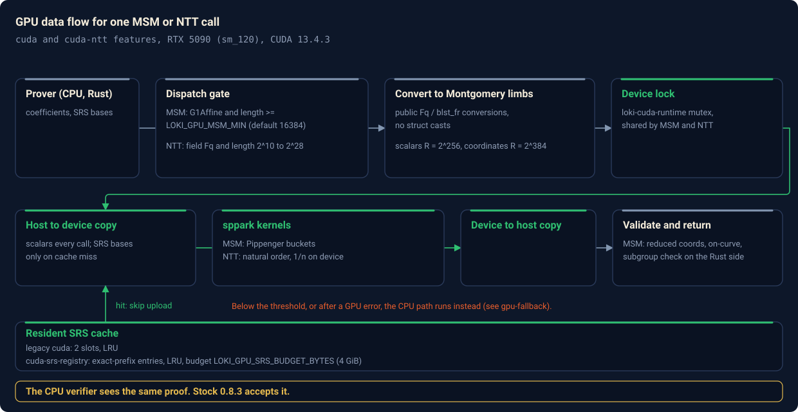
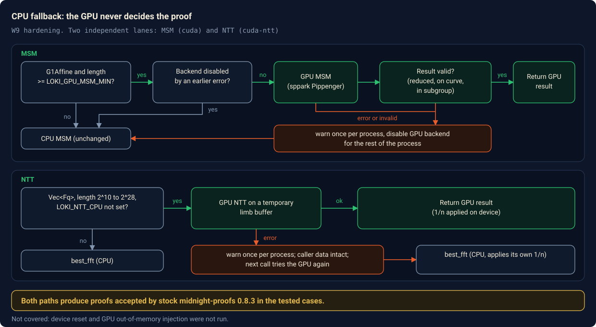
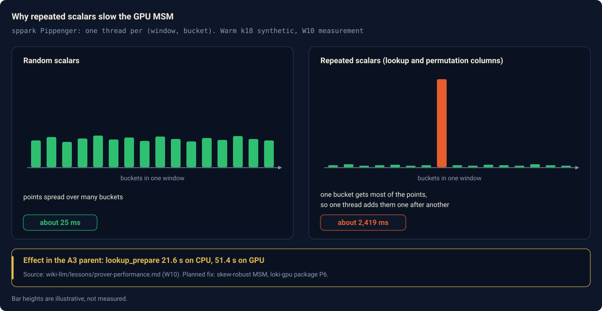

# GPU acceleration in Loki

This page describes the GPU paths that run in Loki, their measurements, and
their limits. It also covers the separate `loki-gpu` backend. P1, the
Loki-side backend API seam, is merged. The P2 runtime is implemented in
`loki-gpu`, while P4 resident NTT work is in progress. The backend's arithmetic
operations remain unsupported.

Loki can run G1 multi-scalar multiplications (MSM) and scalar-field NTTs on an
NVIDIA GPU. Both are opt-in Cargo features with CPU fallback. The kernels are
fast on random inputs, but end-to-end proof time changes little because most
phases still run on the CPU.

In the tested cases, the unmodified stock `midnight-proofs` 0.8.3 verifier
accepts GPU-produced proofs. This establishes verifier compatibility for those
cases. It does not establish byte equality between every CPU and GPU proof.

Sources are `LOKI-GPU-MSM.md`, `LOKI-GPU-NTT.md`, `LOKI-HARDEN.md`,
`LOKI-SRS-REGISTRY.md` and `LOKI-PROFILE.md` in the repository root, the
code, and the prover-performance lessons in the Moriarty-factory wiki.
Links to each are in [Sources](#sources).



## Hardware and toolchain

All GPU results in this documentation come from one host.

| Item | Value |
|---|---|
| GPU | NVIDIA RTX 5090, 32 GB, compute capability `sm_120` |
| CUDA toolkit | 13.4.3, installed outside the system path (`CUDA_HOME`); `nvcc` reports 13.4.92 |
| Host OS | Linux under WSL2, 20 CPU cores, 90 GB RAM |
| Rust | 1.99.1 for validation |
| GPU library | [sppark](https://github.com/supranational/sppark) 0.1.16, Apache-2.0 |

Other GPUs, CUDA versions, native Linux, and Windows are untested.
`LOKI_CUDA_ARCH` accepts digits such as `120` and selects the MSM build target.
`LOKI_NTT_CUDA_ARCH` is passed to `nvcc` as `-arch=<target>`; examples include
`sm_120` and `compute_80`. Alternate targets are untested.

The MSM build links the static CUDA runtime and embeds both native `sm_120`
code and `compute_120` PTX. The NTT build emits `compute_80` PTX plus native
`sm_120` when the toolkit supports it.

## Feature flags

These are the GPU-related features in `Cargo.toml`.

| Feature | Implies | What it does |
|---|---|---|
| `cuda` | `sppark`, `cc`, `loki-cuda-runtime` | G1 MSM on the GPU, with CPU fallback |
| `cuda-ntt` | `loki-cuda-ntt` | Scalar-field NTT on the GPU, with CPU fallback |
| `cuda-srs-registry` | `cuda` | Exact-prefix, budgeted SRS cache in place of the two-slot cache (W13) |
| `loki-profile` | none | Per-phase timing and MSM/FFT counters, including GPU backend counters |
| `loki-harden` | none | Checked domain construction and widened rotation arithmetic (W9) |
| `loki-cpu-budget` | `blst/no-threads` | Single-threaded BLST, with Rayon-partitioned MSM. See the warning below |
| `loki-multiopen` | none | Parallel KZG multi-opening. CPU only |
| `loki-backend-api` | `dep:loki-backend-api` | Opt-in typed backend seam and dispatcher |
| `loki-sppark` | `loki-backend-api`, `cuda`, `cuda-ntt` | Opt-in legacy sppark backend |
| `loki-gpu-backend` | `loki-backend-api`, `dep:loki-gpu`, `loki-gpu/cuda` | Opt-in `loki-gpu` backend; mutually exclusive with legacy `cuda` and `cuda-ntt`. Its arithmetic operations remain unsupported |

`default` is `["committed-instances"]`. No CUDA dependency or backend is enabled by default.

The `loki-deterministic-lookup-order` feature is also opt-in. It sorts lookup
leftovers by field value and changes proof bytes relative to stock.

`cuda` and `cuda-ntt` are independent. You can enable either one, or both.

`loki-cpu-budget` is global to the Cargo build. Cargo unifies features, so it
also makes BLST single-threaded for any other crate in the same build,
including the stock crate. It cost 15% on one benchmark (see
`wiki-llm/lessons/prover-performance.md`). Enable it only on purpose.

A further feature, `cuda-argument-commit` (W10), is described in
[W10: argument commitments](#w10-argument-commitments). It exists on the branch
`loki/w10-gpu-quotient`. It is not in `Cargo.toml` at current Loki main
`a256a9a15ff18ae12a8131b86cff576787fa5e3c`; the historical measurements below
remain tied to their recorded branch and revision.

### Environment variables

| Variable | Read by | Meaning |
|---|---|---|
| `LOKI_GPU_MSM_MIN` | `cuda` | Smallest MSM length sent to the GPU. Decimal. Read once per process. Default 16384. Invalid or unset uses the default. Zero is allowed |
| `LOKI_GPU_SRS_BUDGET_BYTES` | `cuda-srs-registry` | Device budget for resident SRS entries. Default 4294967296 (4 GiB) |
| `LOKI_NTT_CPU` | `cuda-ntt` | If the variable is present at all, NTT uses the stock CPU path. Used for controlled benchmarks |
| `LOKI_NTT_FORCE_ERROR` | `cuda-ntt` | If present, the GPU NTT returns an injected error. Test hook for the fallback |
| `LOKI_CUDA_ARCH` | `cuda` build script | Digits only, such as `120`; the script emits `sm_120` and `compute_120` targets |
| `LOKI_NTT_CUDA_ARCH` | `cuda-ntt` build script | Passed through as `nvcc -arch=<target>`, such as `sm_120` or `compute_80` |
| `CUDA_HOME`, `CUDA_PATH`, `CUDA_TOOLKIT_PATH`, `NVCC` | `cuda` build script | Find the CUDA toolkit; if unset, `nvcc` is searched on `PATH` |
| `CUDA_HOME`, `NVCC` | `cuda-ntt` build script | Find the CUDA toolkit; if unset, `nvcc` is searched on `PATH` |
| `LOKI_PROFILE` | `loki-profile` | Absolute path of a JSONL file. One line is appended per completed proof |

## The accelerated operations

### MSM through sppark Pippenger

Code: `src/poly/kzg/msm.rs` (dispatch), `src/poly/kzg/msm/cuda.rs`,
`src/poly/kzg/msm/cuda/{backend,convert,tests}.rs`, `cuda/msm.cu`.

The `cuda` feature dispatches BLS12-381 G1 MSMs to sppark's Pippenger
implementation. sppark splits each scalar into windows, sorts points into
buckets by window digit, sums each bucket, and combines the bucket sums.

- Dispatch: `msm_specific` tries the GPU first, before zero filtering, so
  the SRS pointer identity stays stable. Only `midnight_curves::G1Affine`
  dispatches. Other curves use the CPU.
- Threshold: the effective length is `min(coeffs.len(), bases.len())`. This
  matches the CPU `zip` semantics. Below `LOKI_GPU_MSM_MIN` (default 16384) the
  call goes straight to the CPU.
- Serialization: one mutex covers all sppark calls, because sppark shares
  its streams. See [The runtime](#the-runtime).
- Resident SRS: the bases are uploaded once and kept on the device
  with their bucket workspaces. The legacy cache holds at most two arrays
  with LRU eviction. The cache key is the source pointer plus the effective
  length, and every hit compares the retained coordinates exactly. This costs
  an O(n) host scan on warm calls.
- Build detail: `build.rs` generates a shadow of sppark's `pippenger.cuh`
  that changes only `~msm_t()` to `~msm_t() noexcept(false)`. The unmodified
  destructor calls throwing CUDA helpers under an implicit `noexcept`.
  The extern "C" boundaries catch CUDA, standard and unknown exceptions.

### NTT

Code: `cuda-ntt/` (crate `loki-cuda-ntt`), `cuda-ntt/cuda/ntt.cu`, and the
dispatch in `src/poly/domain.rs`.

The `cuda-ntt` feature runs sppark's BLS12-381 `Fr` NTT. The unsafe FFI lives
in the small `loki-cuda-ntt` crate. The main crate keeps its ban on unsafe
code.

- Eligibility: the vector must be `Vec<Fq>` (a checked `Any` downcast).
  Other field types keep the stock `best_fft`. The length must be between 2^10
  and 2^28. Below 2^10 the CPU runs.
- Variant: natural-order input and output, standard (not sppark coset)
  NTTs. Coset powers, zero padding, truncation and rotations stay in the
  stock host code in `domain.rs`.
- Roots: the domain root is compared with sppark's table before every
  launch. A mismatch is an error, and the input is left unchanged.
- Inverse: sppark's inverse already multiplies by 1/n. The GPU path
  returns early only on success, so the domain never applies 1/n twice.
  On the CPU branch the domain applies its own divisor.
- Serialization: the same mutex as MSM. A call returns its buffer to the
  host before it finishes.

NTT results stay on the host between calls. Device-resident columns are not
implemented.

### The runtime

Code: `cuda-runtime/src/lib.rs` (crate `loki-cuda-runtime`, 13 lines).

It holds one process-wide `Mutex` that every sppark call takes, including
resident allocation, invocation and release. The lock order is device lock,
then cache lock. A shared crate means MSM and NTT use the same lock even when
only one of them is linked into a given binary. The lock covers the threads
of one process. It does not coordinate separate OS processes.

### W10: argument commitments

Status: on branch `loki/w10-gpu-quotient`, not in main.

The lookup and permutation arguments are commitments to columns that are full
of repeated values. The GPU MSM is slow on that shape (see
[the repeated-scalar skew](#the-repeated-scalar-skew)). W10 instead commits the
same polynomials in coefficient form, using the coefficient polynomials the
prover already computes for openings. The commitments are equal by the basis
change identity `Contract.commitLagrange_eq_commit` in the Lean spec.

The feature is `cuda-argument-commit = ["cuda"]`. It applies only when
`params.max_k() == domain.k()`. Otherwise the stock prefix-Lagrange commitment
is used. It adds no RNG calls and no transcript events. It assumes a consistent
SRS, which a valid KZG setup guarantees but arbitrary `from_parts` input does
not.

### W13: the SRS registry

Code: `src/poly/kzg/msm/cuda/backend.rs`, feature `cuda-srs-registry`. In main.

The legacy cache keyed entries by pointer and length, with two slots. For a
prover that commits against several SRS prefixes, that caused repeated
validation and upload. The registry replaces it, only under the feature, with:

- entries keyed by address and capacity, with an exact comparison of the
  requested prefix on every hit;
- LRU eviction under `LOKI_GPU_SRS_BUDGET_BYTES`, charging sppark's persistent
  points, buckets and histogram, not only the 96-byte base payload;
- validation of upload candidates on up to four native scoped workers for
  n >= 4096, serial below that;
- a rejection before upload when one entry exceeds the budget.

The address is a search filter. It is never a soundness assumption. A hit
needs all x/y/z limbs of the requested prefix to equal the validated host
snapshot. The snapshot costs 144 bytes per point on the host. The device wire
is 96 bytes.

### CPU fallback and W9 hardening

W9 (`LOKI-HARDEN.md`, feature `loki-harden` for the non-GPU parts) fixed how
the GPU path fails.



- MSM: a GPU error returns to the unchanged CPU path and logs one
  `tracing::warn!` per process. The backend then stays disabled for the rest
  of the process. There is no automatic recovery.
- NTT: an error returns to `best_fft` and logs one warning per process.
  The adapter works on a temporary limb buffer, so the caller's data is intact.
  The NTT backend is not disabled; the next eligible call tries the GPU again.
  Before W9, an NTT error panicked.
- Upload validation: each new SRS upload checks curve membership before
  normalization and subgroup membership before the FFI call. The regression
  rejects an off-curve point and an order-three point. The legacy `cuda` cache
  performs this validation serially per upload, which adds cold-cache cost.
  With `cuda-srs-registry`, candidates of length n >= 4096 use up to four
  native scoped workers, as described above.
- Native boundary: every `extern "C"` function catches all exceptions
  and returns an error code.
- Arithmetic edges: a domain size of 2^32 truncated to zero in `i32` in
  the old rotation code. The hardened path keeps `usize` dimensions and uses
  `i128` for the index. `EvaluationDomain::try_new` rejects zero degree,
  invalid shifts and size overflow instead of truncating.

Not tested: a deliberate device reset, GPU out-of-memory injection, and
teardown failures. The no-device case and injected adapter errors are tested.

### Profiling

Feature `loki-profile` (`LOKI-PROFILE.md`). Call
`midnight_proofs::profile::take_report()` after `create_proof`, or set
`LOKI_PROFILE=/absolute/path.jsonl`.

The report gives exclusive wall time per prover phase (the sum equals
`total_wall_ns`), plus MSM and FFT counters with size histograms. Under the
GPU features, each phase also has a `backends` map with counters such as
`msm.prepare`, `msm.prepare.hit`, `.miss`, `.validation`, `.upload`,
`.upload_bytes` and `.evict`. Those are sub-timings inside a phase. Do not add
them to the phase total. Keygen and verification are not recorded. The report
holds no witness, SRS, key or transcript values.

## How data moves

For one MSM or NTT call:

1. Host to limbs: field elements and points are converted to arrays of
   little-endian `u64` limbs, using the public `Fq`/`blst_fr` and curve
   getter conversions. The adapter never casts the Rust struct layout. A
   little-endian host is required, and C++ static assertions check wire sizes
   and alignments against the sppark types.
2. Montgomery form: scalars and the scalar field use R = 2^256.
   Base-field coordinates use R = 2^384. Both sides use reduced Montgomery
   residues, so no extra conversion is needed on the device. The infinity
   point is the affine pair (0, 0).
3. Upload: scalars are copied on every call. SRS bases are copied only on
   a cache miss, after validation, and stay resident. The initial upload
   synchronizes before the host buffer is released.
4. Kernels: MSM computes buckets and window sums on the device. sppark
   returns a Jacobian result and the native side converts it to affine.
5. Download and check: for MSM, the Rust side checks that coordinates are
   reduced, that the point is on the curve, and that it is in the subgroup.
   For NTT, the data is copied back only after a successful synchronize.
6. Active device: CUDA's active device is thread-local, so it is set on
   every FFI entry.

Warm MSM timings in the table below include source-coordinate validation,
scalar conversion and upload, kernels, host reduction, output validation and
synchronization. They are not bare kernel times.

The legacy adapters use ordinary pageable `Vec` buffers and do not use pinned
staging. See [WSL2 and pinned memory](#wsl2-and-pinned-memory).

## Building and running

The CUDA toolkit must be reachable. Either set `CUDA_HOME` or put `nvcc` on
`PATH`.

```sh
export CUDA_HOME=$HOME/.local/opt/cuda-13.4.3
export PATH=$CUDA_HOME/bin:$PATH

# MSM only
cargo build --release --features cuda
# NTT only
cargo build --release --features cuda-ntt
# Both, with the registry cache
cargo build --release --features cuda-srs-registry,cuda-ntt
```

In a downstream crate, Loki is a drop-in replacement through
`[patch.crates-io]`. Enable the GPU features on the patched crate.

To confirm that the GPU actually ran, use `loki-profile` and check that the
MSM and FFT counters are non-zero. A run that silently fell back looks like a
CPU run.

```sh
RAYON_NUM_THREADS=4 LOKI_PROFILE=$PWD/profile.jsonl \
  cargo run --release --features cuda,cuda-ntt,loki-profile \
  --example loki-profile -- 17
```

GPU tests are marked `#[ignore]` so that ordinary `cargo test` never touches a
device. Run them explicitly and serially:

```sh
cargo test --release --features cuda --lib gpu_differential -- --ignored --nocapture --test-threads=1
cargo test --release --features cuda-ntt --lib gpu_ntt_equality -- --ignored --test-threads=1 --nocapture
```

The project's own GPU jobs run through a host job runner (`gpu-runner`) that
serializes access to the one device. That runner is lab infrastructure, not a
Loki feature.

## How the GPU path is checked

The tests compare GPU results with CPU results and separately check that GPU
proofs pass the independent stock verifier. The checks are listed below.

| Layer | What it checks | Where |
|---|---|---|
| Conversion tests | 1024 big-integer comparisons and point round trips, including zero, one, the maximum scalar and the identity | W4, `LOKI-GPU-MSM.md` |
| MSM differential | 10,108 cases: power-of-two boundaries through 2^16 +/- 1, zero scalars, identity bases, maximum scalars, cancellation, in-place mutation, mismatched lengths, eight concurrent callers. Each call goes to the GPU backend directly, so a fallback cannot hide an error | W4 |
| MSM large boundaries | 2^17 +/- 1 through 2^22 +/- 1, 12 sizes, with a maximum scalar at the last base | W4 |
| NTT equality | 1260 comparisons: logs 10 to 23, six input patterns, extension factors 1, 2 and 4, all five domain conversions, with exact successful-GPU-call counts | W5, `LOKI-GPU-NTT-EQUALITY.csv` |
| Strict dispatch | A test that fails if an eligible transform did not execute on the GPU. A matching CPU answer alone does not pass | W5 |
| Registry gates | Prefix reuse, same-address mutation, off-curve and torsion rejection, LRU eviction, four interleaved k19/k20 arrays against stock CPU MSM | W13 |
| Fallback tests | Forced NTT error in a subprocess, compared to CPU oracles for all five conversions. The no-device MSM test | W9 |
| Concurrency | Four concurrent provers: every proof verifies, and the successful MSM and NTT dispatch counts are exactly four times a reference proof | W9 |
| Stock-verified proofs | A GPU-produced proof is read by an unmodified crates.io `midnight-proofs` 0.8.3 verifier from a separate package with no path dependency or patch | below |

The stock verification evidence is:

- MSM: a k8 proof (416 bytes) with `LOKI_GPU_MSM_MIN=1`, so the GPU
  runs on a small proof. Stock accepted it. A changed public input was rejected.
- NTT: three k17 GPU proofs (1344 bytes each, 17 GPU NTTs per proof)
  and three CPU-mode proofs were accepted by stock. Every wrong-public-input
  mutation was rejected. This establishes verifier acceptance for both modes;
  the test does not compare CPU and GPU proof bytes.
- A3 parent: the k20 Sherlock parent proof from the W10 run was
  verified by an independent stock-registry verifier and every negative control
  was rejected (`gpu-lab/luna-2/W10-A3-STOCK.md`). The checked-in
  [A3 stock-verifier probe](../probes/a3-stock-verify/README.md) describes the
  independent verification method and inputs.
- Whole gate: W9's full 13-stage gate passed, including the W2 harness
  (k10, k14 and k17 cross-verify with equal verification keys).

Compatibility has an upstream limit. If one `create_proof` call contains at
least two proofs and both committed and plain instance columns, the stock
prover and verifier absorb those instances in different orders. Stock rejects
its own proof in this case, and Loki behaves the same. The positive results
above cover the tested cases. See `LOKI-FUZZ.md`, finding 1.

The Lean theorem `Refinement.loki_proof_eq_stock` proves equality of modeled
proof events when the backend satisfies `Refines` and `SameOrder`, for identical
model inputs, RNG draws, thread count, and fixed lookup-map order. `SameOrder`
requires commitment events in stock order. Stock lookup preparation uses a
`HashMap`, whose iteration order can vary across processes; the vanishing
randomness also depends on the Rayon thread count. Loki's default build uses
the same `HashMap` iteration behavior. The opt-in
`loki-deterministic-lookup-order` feature sorts lookup keys and changes proof
bytes relative to stock. Byte equality therefore requires the same lookup
order and thread count. The theorem does not establish that the Rust, FFI, or CUDA implementation satisfies
`Refines`; those code paths are not connected to the Lean model. See
`LokiLean/{Ntt,Msm,Refinement,Plonk}.lean` and `LOKI-QUINT.md`.

## Measured results

Every number here is one shared-host measurement unless the source says
otherwise. They are not whole-prover speedups unless the row says so.

### Kernel level

MSM, milliseconds, `LOKI-GPU-MSM.md`. Cold means an empty SRS cache. Warm is
the mean of three calls. The first cold row includes CUDA context startup.
Scalars are random.

| log2(n) | CPU | GPU cold | GPU warm |
|---:|---:|---:|---:|
| 16 | 72.692 | 307.278 | 6.927 |
| 17 | 108.222 | 32.333 | 14.468 |
| 18 | 221.874 | 55.652 | 24.440 |
| 19 | 430.804 | 132.956 | 31.312 |
| 20 | 759.250 | 247.003 | 57.657 |
| 21 | 1,435.199 | 486.217 | 100.870 |
| 22 | 3,005.208 | 1,153.978 | 181.221 |

Warm speedup is 13.17x at 2^20 and 16.58x at 2^22.

NTT, one call, CPU / GPU in milliseconds, extension factor 1, median of three
(`LOKI-GPU-NTT-BENCH.csv`, 140 combinations in the full file).

| Operation | k17 | k20 | k23 |
|---|---:|---:|---:|
| `coeff_to_lagrange` | 8.280 / 2.184 | 122.470 / 46.629 | 1323.385 / 350.314 |
| `lagrange_to_coeff` | 7.739 / 2.189 | 121.632 / 46.360 | 1181.203 / 385.162 |
| `coeff_to_extended` | 7.294 / 2.614 | 130.324 / 49.466 | 1652.929 / 403.127 |
| `extended_to_coeff` | 8.210 / 2.682 | 141.668 / 50.752 | 1665.055 / 447.421 |
| `extended_to_lagrange` | 15.235 / 4.562 | 245.846 / 82.421 | 2017.758 / 669.064 |

### Synthetic k17 proof (W5)

Same executable, same keys, three proofs per backend, medians
(`LOKI-GPU-NTT.md`). Ordering and shared-host noise apply.

| Phase | CPU ms | GPU ms | Ratio |
|---|---:|---:|---:|
| Numerator, including column extension | 349.819 | 176.309 | 1.98x |
| Vanishing division and inverse coset recovery | 28.121 | 10.606 | 2.65x |
| Quotient, including its CPU MSM commitments | 723.207 | 512.459 | 1.41x |
| Complete `create_proof` | 2172.838 | 1950.617 | 1.11x |

### W13 SRS registry (k17 fixture)

Median of three, `cuda` versus `cuda-srs-registry`, Rayon 4, BLST 1
(`LOKI-SRS-REGISTRY.md`).

| Metric | Legacy | Registry |
|---|---:|---:|
| `create_proof` (ms) | 8968.678 | 2479.872 |
| SRS preparation (ms) | 7460.926 | 968.290 |
| Uploads | 2 | 1 |
| 2^20 - 1 MSM after a full MSM (ms) | 29879.869 | 53.333 |

SRS preparation for k17 falls from about 7.46 s to 0.97 s. These times are dominated by on-curve and subgroup
validation of the SRS, not by upload. The fixture is synthetic. It is not an
estimate of chain speed. The 2^20 cold full MSM of about 30 s in the legacy
column is the cost of validating a 2^20 SRS point by point, so it does not
compare to the MSM table above, which uses a warm cache.

### The real workload: the k20 Sherlock parent (A3)

Circuit `mori-recursion::SherlockLinkRelation`, k=20, `RAYON_NUM_THREADS=4`,
on the same host. The W10 comparison was run on branch
`loki/w10-gpu-quotient`; each value is a single sample. Both W10 values are
prove-plus-verify intervals. The detailed results are in
`Moriarty-factory/wiki-llm/loki/gpu-lab/astra/RESULTS.md` and
`Moriarty-factory/wiki-llm/loki/gpu-lab/astra/RESULTS-DETAILS.md`.

| Run | Prove and verify | Source |
|---|---:|---|
| Stock 0.8.3 | 220.2 s | prover-performance lessons |
| Loki CPU | 252.6 s | same |
| Loki with GPU MSM and NTT | 220.8 s | same |
| W10 clean GPU baseline | 294.285 s | `Moriarty-factory/wiki-llm/loki/gpu-lab/astra/RESULTS.md` |
| W10 with argument commitments | 237.808 s | `Moriarty-factory/wiki-llm/loki/gpu-lab/astra/RESULTS.md` |

The matched W10 pair reduced prove-plus-verify time by 56.477 s, or 19.1913%.
Within `create_proof`, the interval fell from 206.230720970 s to
143.825054089 s, a reduction of 62.405666881 s. The time outside
`create_proof` increased from 88.054279030 s to 93.982945911 s. All 45 MSMs
and 79 NTTs ran on the GPU with no fallback, and stock accepted the optimized
proof. The independent stock verification method and inputs are described in
the checked-in [A3 stock-verifier probe](../probes/a3-stock-verify/README.md).
The measurements are single samples, not medians or a recursion-chain result.

The plain GPU path took 220.8 s, compared with 220.2 s for stock on this
circuit. The W10 baseline used a separate run and different accounting, so
294.285 s is not directly comparable with 220.8 s. W10 targets the lookup and
permutation regression. These results do not show the plain GPU path beating
CPU here.

## Known limits

### The repeated-scalar skew

sppark's Pippenger assigns each (window, bucket) pair to one thread. Lookup
and permutation columns hold many repeated values. When most scalars in a
window are equal, most points land in one bucket and one thread adds them in
sequence.



On a warm k18 synthetic, wide repeated scalars took about 2,419 ms. Random
scalars took about 25 ms. In the A3 parent this made `lookup_prepare` slower
on the GPU: 51.4 s against 21.6 s on the CPU. `permutation_products`
regressed the same way (23.8 s against 10.6 s) per the W10 plan.

Mitigations:

- W10 commits those columns in coefficient form (see above), which are not
  skewed. It is a workaround on a branch.
- A skew-robust MSM with bounded bucket segments is designed in the
  `loki-gpu` repository. It is Planned (package P6).
- A code path that sends skewed MSMs back to the CPU is not implemented.
  The dispatch looks only at length.

Benchmark real-circuit scalar distributions alongside random inputs.

### The time is in CPU phases

Faster kernels moved the end-to-end time very little. The profile of a
synthetic k16 CPU proof (`LOKI-PROFILE.md`, 1127.287 ms in total) shows where
the time goes. These are phases that the current GPU features do not touch:

| Phase | Share of `create_proof` |
|---|---:|
| `quotient_evaluation` | 18.58% |
| `kzg_multiopen` | 18.76% |
| `quotient_commitment` (MSM) | 16.87% |
| `advice_commitments` (MSM) | 7.80% |
| `lookup_products` | 6.92% |
| `compute_nu_poly` | 6.58% |
| `other` | 6.81% |

That fixture is synthetic and is not the k20 parent. On the real parent, the
lessons file names synthesis, quotient evaluation, lookup preparation and
multiopen as the time still on the CPU. In the W10 pair below, `create_proof`
is 143.83 s of the 237.81 s window. The other 94.0 s lies outside it, where
no MSM or NTT kernel runs.

Another result in the same direction: a CPU micro-optimization measured
1.83x and 2.85x on its own and moved the k16 end-to-end time from 1,767 to
1,781 ms. Kernel numbers are unproven until the full proof moves.

The owner prioritizes end-to-end recursion-chain latency over raw kernel speed.

### WSL2 and pinned memory

The host runs CUDA under WSL2. NVIDIA documents that pinned (page-locked)
host memory is limited under WSL2. The legacy sppark adapters copy through
ordinary pageable `Vec`s, so their transfers are synchronous. No transfer-overlap speedup is claimed or measured
for those adapters.

The P2 runtime in `loki-gpu` implements a bounded pinned staging ring with two
initial slots of 32 MiB each, a four-slot maximum, and a pageable fallback.
The opt-in `loki-gpu-backend` feature includes this runtime. Its effect on
transfer overlap under WSL2 remains unmeasured.

### Other limits

- A single process-wide lock serializes MSM and NTT. They never overlap.
  Cross-process access is not coordinated.
- Only one device is used (`select_gpu(0)`).
- NTT data returns to the host after every call. There are no resident
  columns, no fused numerator and no GPU quotient evaluation.
- The NTT threshold of 2^10 is a prototype policy, not an autotuned
  crossover. The MSM threshold of 16384 is likewise a default.
- Cold-cache validation of a large SRS is slow (about 7.5 s at k17 in the
  legacy cache, see the W13 table).
- No constant-time claim is made for any GPU path.
- Lengths above 2^23 for NTT and teardown failures have not been exercised.
- Long combined test jobs (log 22 and 23 NTT matrices) were interrupted twice
  for an undiagnosed reason and were split into smaller jobs.
- Not run: Rust 1.76, 32-bit targets, devices other than the RTX 5090.

## The separate backend: loki-gpu

`loki-gpu` is a separate Apache-2.0, clean-room backend. Its P2 transactional
runtime and versioned ABI are implemented in repository main at
`d71b7cafd4308206cc7f283b07a4e67baae89305`. P1, the Loki-side backend API
seam, is merged in Loki main at `a256a9a15ff18ae12a8131b86cff576787fa5e3c`.
P4 resident NTT is in progress. P1 typed MSM/transform dispatch is integrated
in Loki main. The opt-in `loki-gpu-backend` feature exposes the runtime, but
MSM, NTT, quotient, and SRS arithmetic operations still return `Unsupported`.

The sppark adapters described on this page remain Loki's working GPU path and
correctness baseline. Loki's `loki-backend-api` seam is opt-in, and
`loki-gpu-backend` cannot be combined with the legacy `cuda` or `cuda-ntt`
features. Repository details are in the `loki-gpu` README and `docs/OVERVIEW.md`.

The plan is in `design/PLAN.md` of that repository. The packages, in order:

| Package | Content | Status |
|---|---|---|
| P1 | Stock CPU plug-in seam in Loki | Merged |
| P2 | Transactional device runtime and versioned C ABI | Implemented in loki-gpu; available through an opt-in Loki feature |
| P3 | Legacy sppark adapter and validated SRS registry behind the new API | Planned |
| P4 | Resident NTT and exact coset pipeline | In progress |
| P5 | Quotient bytecode compiler and CUDA interpreter | Planned |
| P6 | Skew-robust MSM (conditional on remaining budget) | Planned |
| P7 | Whole-chain integration and one-heavy-job scheduler | Planned |
| P8 | Lookup compression and preparation (conditional) | Planned |
| P9 | Measured batching, precompute and concurrent-heavy admission (conditional) | Planned |

The order follows the measurements above. The time sits in the quotient and
lookup phases, so the plan puts residency, the quotient interpreter and
chain integration first, and the MSM rewrite behind a measured gate.
Performance packages need a measured gain on the whole chain before they are
admitted. No 10x claim follows from kernel timings.

## Sources

In the repository root:

- [`LOKI-GPU-MSM.md`](../LOKI-GPU-MSM.md) (W4)
- [`LOKI-GPU-NTT.md`](../LOKI-GPU-NTT.md), [`LOKI-GPU-NTT-BENCH.csv`](../LOKI-GPU-NTT-BENCH.csv),
  [`LOKI-GPU-NTT-EQUALITY.csv`](../LOKI-GPU-NTT-EQUALITY.csv) (W5)
- [`LOKI-HARDEN.md`](../LOKI-HARDEN.md) (W9)
- [`LOKI-SRS-REGISTRY.md`](../LOKI-SRS-REGISTRY.md) (W13)
- [`LOKI-PROFILE.md`](../LOKI-PROFILE.md) (W1)
- [`LOKI-CPU.md`](../LOKI-CPU.md) (`loki-cpu-budget`)

Outside the repository (Moriarty-factory wiki):

- `wiki-llm/lessons/prover-performance.md`
- `wiki-llm/loki/gpu-lab/astra/SESSION.md` and `luna-2/FINAL-CLAIMS.md` (W10 A3 pair)
- `wiki-llm/loki/gpu-lab/luna-2/W10-A3-STOCK.md` (stock verification of the A3 proof)
- W10 plan: `docs/superpowers/plans/2026-10-25-w10-argument-commit.md` on the W10 branch

Code: `src/poly/kzg/msm/cuda/`, `cuda/msm.cu`, `cuda-ntt/`, `cuda-runtime/`,
`src/poly/domain.rs`, `src/profile.rs`.
