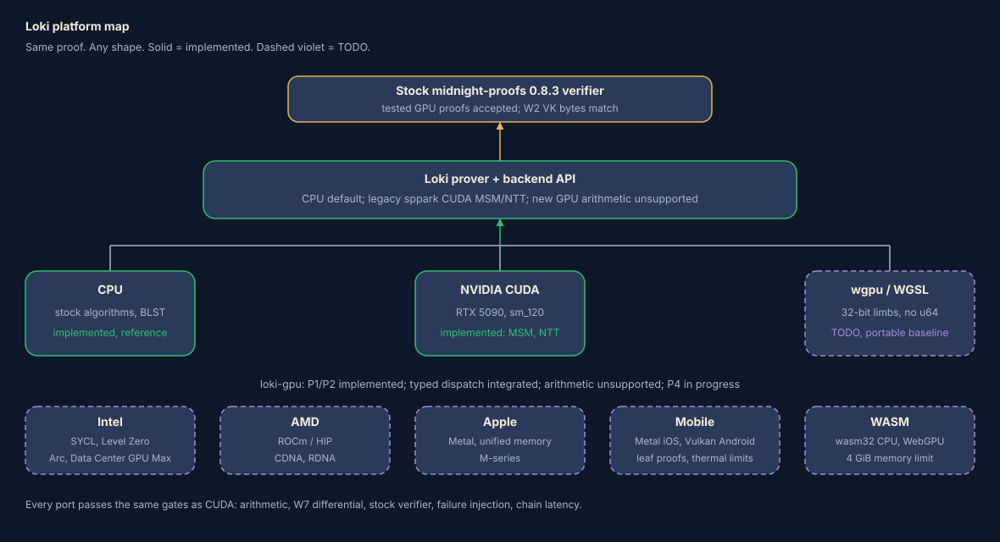

# Platforms beyond NVIDIA CUDA: acceleration roadmap

Status: CUDA is the only GPU target with accelerated MSM and NTT operations.
The opt-in `loki-backend-api` seam and CPU adapter are implemented. The separate
`loki-gpu-backend` feature builds a skeleton that advertises no accelerated
operations. Other GPU targets remain roadmap items. See the [GPU overview](GPU.md)
and [P1 seam note](../LOKI-P1-SEAM.md).

| Target today | Status |
|---|---|
| CPU (stock algorithms, BLST, rayon) | Implemented. Reference for other backends. |
| NVIDIA CUDA, RTX 5090 (sm_120, CUDA 13.4.3) | Legacy sppark MSM and NTT are implemented behind `cuda`, `cuda-ntt`, and `cuda-srs-registry` (see [`Cargo.toml`](../Cargo.toml)). The new `loki-gpu-backend` skeleton does not advertise accelerated operations. |
| Intel, AMD, mobile, WASM, Apple | TODO, described below. |

Measured facts that shape the plan. These values come from the [GPU MSM note](../LOKI-GPU-MSM.md), the [profiling note](../LOKI-PROFILE.md), and the project notes. They were not remeasured for this page.

- W10 GPU argument commitments: A3 Sherlock parent prove and verify took 294.3 s and 237.8 s, respectively, a 19.2% reduction in one matched sample per side. The result is from a branch and covers one parent, not a complete recursion chain. See [GPU results](GPU.md#the-real-workload-the-k20-sherlock-parent-a3).
- W13 exact-prefix SRS registry: k17 preparation fell from 7.46 s to 0.97 s.
- GPU MSM slows on repeated scalars (2.4 s vs 25 ms at k18).
- Kernel speedups alone made little difference to end-to-end time. CPU phases still take most of the time.
- The owner prioritizes recursion-chain latency over kernel peak speed.

## 1. Rules every port obeys

Every port must meet these requirements before it ships.

1. Stock `midnight-proofs` 0.8.3 must accept proofs produced with the backend, and VK bytes must match. The [W2 harness](../loki-harness/README.md) checks this for its covered cases.
2. Each operation must match the CPU output bit for bit on the [W7 differential fuzz corpus](../LOKI-FUZZ.md), including empty input, zero scalars, infinity points, repeated scalars, MSM length mismatch (`ZipTruncate`), and NTT sizes, directions and coset shifts up to the advertised maximum.
3. Return `Unsupported`, capacity, allocation and kernel errors to the caller. In GPU-required test mode, any fallback fails the gate. The rule is described in loki-gpu `design/ARCHITECTURE.md`, under "Async, errors, and fallback"; that source has no canonical public URL in this checkout.
4. Keep randomness, Fiat-Shamir, proof encoding and verifier policy in Loki. Backends perform arithmetic.
5. Compare complete-chain time against CPU and CUDA on the same machine before calling a port faster. The measurement must include Sherlock leaf, parent and decider proofs. W10 measures one A3 parent, not a complete chain.
6. Keep feature flags opt-in and off by default. The default build stays stock.

The checklists use acceptance gates G1 to G6:

- G1, arithmetic: field and curve unit vectors match CPU results, including the edge cases above.
- G2, differential: run the W7 fuzz cases, N cases per operation, with zero mismatches.
- G3, stock verifier: the stock 0.8.3 verifier accepts proofs from a CPU-plus-backend run, and VK bytes match.
- G4, failure: injected allocation, launch and context-loss failures follow the error table in loki-gpu `ARCHITECTURE.md`.
- G5, repeated scalars and skew: avoid pathological slowdown relative to the CUDA baseline or document a fallback rule.
- G6, chain latency: report a matched whole-chain Sherlock wall-time comparison with CPU phases included.

## 2. What the backend API has to provide

The API and its CUDA-neutral design are described in loki-gpu at
`loki-gpu/crates/loki-backend-api/src/lib.rs` and
`design/ARCHITECTURE.md`. Those local source paths have no canonical public URL
in this checkout. The [Loki GPU overview](GPU.md)
summarizes the design. The points below describe what each non-CUDA target
would stress.

Operations in the API: `Msm`, `Transform` (NTT), `Upload`, `Download`,
`ResidentTransform`, `Quotient` (a register-program interpreter),
`SrsAcquire`/`SrsMsm`/`SrsRelease`, plus `Runtime`, `Reserve`, `Release`.

Capabilities (`BackendCapabilities`): `host_msm`, `host_transform`,
`resident_buffers`, `resident_transform`, `quotient_interpreter`,
`srs_registry`, `supported_arithmetic` (exact field and curve wire ABI;
today BLS12-381 scalar and G1 only), `max_transform_log`,
`device_memory_budget`. A target advertises the capabilities it supports. The adapter
falls back per operation, which supports partial backends such as
"MSM only".

Error model (`ErrorKind`): `Unsupported`, `InvalidInput`, `Capacity`,
`Allocation`, `Transfer`, `Kernel`, `Synchronization`, `ContextLost`,
`Poisoned`, `Internal`, with a `FailureEffect` (`NotStarted`,
`InputsPreserved`, `SessionPoisoned`). Targets that lose devices often
(mobile backgrounding, browser tab suspension, WebGPU device loss, thermal
kills) map onto `ContextLost` and `Poisoned`.

Memory model: resident buffers carry an owning context, a generation and
an allocation id. v1 calls block until checked completion. SRS leases are
keyed by exact validated content.

Platform questions, all tracked as `TODO(platform)`:

- Unified memory on Apple and mobile: the API models upload and download as separate steps. Shared memory could avoid copies. A `MemoryKind` capability for discrete, unified and host-shared memory may help the scheduler account for staging buffers (O1).
- Device-memory budget: `device_memory_budget: Option<u64>` represents a fixed budget. Mobile and browser limits can vary at runtime; a budget-change event may be needed (O2).
- Per-device arithmetic ABI: a WGSL backend may store field elements in a different 32-bit-limb representation. Keep that representation inside the backend and retain `WIRE_ENCODING_V1` as the wire contract.
- Blocking completion: WebGPU readback uses asynchronous `mapAsync`. A backend may need a worker, or the API may need an async variant (O3). The loki-gpu design says a later async API must be leak-safe under `mem::forget`.
- Quotient interpreter: the current opcodes are add, sub, mul, square, double and negate on field registers (`QuotientOpcode`). A port needs a correct field multiply.

## 3. Operation mapping (all targets)

| Operation | Shape | What a port needs |
|---|---|---|
| MSM | Large-window bucket method over 255-bit scalars and BLS12-381 G1 points. Dominant cost in commitments. | Field mul/add over the 381-bit base field, point add in projective or XYZZ form, sort or bucket-count kernel, reduction. Atomic or sort-based bucket assignment. |
| NTT | Radix butterflies over the 255-bit scalar field, sizes up to 2^k (extended domain larger). | Field mul/add over the 255-bit scalar field, twiddle tables, strided global-memory passes. Memory-bandwidth bound at large size. |
| Quotient evaluation | Gate, permutation and lookup expressions over the extended domain, as a register program. | Field arithmetic plus large resident working set. Memory capacity is the constraint. |
| Lookup preparation | Sorting and permuting lookup columns, currently CPU phases. | Not a GPU kernel today in Loki. Listed because the profile shows CPU phases dominate (see section 11). |
| SRS residency | Keep validated SRS bases on device across proofs (W13 on CUDA). | Device-memory budget, exact-content identity and eviction. A k20 SRS uses about 96 MiB in the 96-byte GPU wire format, before cache bookkeeping and scratch ([registry note](../LOKI-SRS-REGISTRY.md)). |

## 4. The arithmetic problem, once

Loki uses the BLS12-381 scalar field (255 bits) and base field (381 bits),
both with Montgomery multiplication. A 381-bit value fits in six 64-bit limbs
or twelve 32-bit limbs. A schoolbook Montgomery multiply takes about 2n^2 + n
limb multiply-adds for n limbs; actual GPU throughput depends on the target.

- NVIDIA PTX `mul.wide` supports 16-bit and 32-bit operands, not 64-bit operands. A 64-by-64-bit product therefore needs a multi-limb sequence; the CUDA code uses 32-bit multiply-adds and carry chains such as `mad.cc` ([PTX integer arithmetic](https://docs.nvidia.com/cuda/archive/13.0.0/parallel-thread-execution/index.html#integer-arithmetic-instructions-mul)). This statement is about the PTX path, not every GPU ISA.
- Measure 64-bit integer throughput on each target (O4). Use 32-bit limbs as the portable baseline: 12 limbs for Fp and 8 for Fr. Compare 64-bit limbs by microbenchmark.
- Carry propagation differs by ISA. PTX provides carry-chain instructions. AMD's [machine-readable ISA specifications](https://gpuopen.com/machine-readable-isa/) are the source to check for the selected RDNA or CDNA generation. Other backends need target-specific carry code.
- All ports must return canonical reduced outputs, as required by the API. They may use lazy reduction internally if G1 verifies the boundary result.
- Reuse the CPU test vectors. The Lean spec (`loki-lean`, gpu-spec worktree) models arithmetic abstractly; it does not verify a kernel.

Public references include [sppark](https://github.com/supranational/sppark)
and [cuZK, TCHES 2023](https://tches.iacr.org/index.php/TCHES/article/view/10961).
The loki-gpu `design/ARCHITECTURE.md` source-reuse rule requires exact
attribution and a NOTICE update before sppark source is used.

## 5. Intel (TODO)

### API options

| API | Notes |
|---|---|
| oneAPI DPC++ / SYCL | Single-source C++ option. [Intel DPC++ compiler](https://www.intel.com/content/www/us/en/developer/tools/oneapi/dpc-compiler.html) |
| Level Zero | Low-level API for device, memory and command-queue management. [Level Zero specification](https://oneapi-src.github.io/level-zero-spec/) |
| OpenCL | Another option where device drivers expose it. [Khronos OpenCL](https://www.khronos.org/opencl/) |
| Vulkan compute / wgpu | See section 9 and 10. Possible but not an Intel-specific path. |

First option to evaluate: SYCL with a Level Zero backend, called from Rust
through a small C ABI shim. The loki-gpu design uses a versioned C ABI in
`ffi.rs`.

Hardware includes Arc A-series and B-series GPUs and Data Center GPU Max
(Ponte Vecchio). Intel lists 128 GB HBM for Max 1550 and 48 GB for Max 1100
([Intel product specifications](https://www.intel.com/content/www/us/en/ark/products/codename/199326/products-formerly-ponte-vecchio.html)).
Measure memory capacity and bandwidth on the target system before planning SRS
or quotient residency.

Potential operation mapping: MSM, NTT, quotient and SRS residency. Query
subgroup width on the target rather than assuming CUDA's 32-lane warp. SYCL
local memory can hold per-workgroup data.

Integer arithmetic remains an open measurement. TODO(platform): compare
32-bit and 64-bit limb operations on an Arc GPU, including the 32x32 to 64-bit
multiply path, before choosing a representation. The [Intel graphics reference
manual](https://www.intel.com/content/www/us/en/docs/graphics-for-linux/developer-reference/1-0/overview.html)
has not been checked for this page.

Backend API questions: model device memory as discrete, and add a vendor
identifier to capabilities so the arbiter can select a device. Multi-tile Max
parts need a device-selection rule.

Prior-art search for Intel GPU MSM or NTT on BLS12-381 remains open (O5).

### Checklist

- [ ] Detect Intel GPUs through Level Zero; fill `BackendCapabilities`.
- [ ] 32-bit-limb Fr and Fp Montgomery mul, add, sub in SYCL; G1.
- [ ] Microbenchmark 32-bit vs 64-bit limb throughput; record numbers in this file.
- [ ] NTT, natural-order output, up to the CUDA-equal `max_transform_log`; G1, G2.
- [ ] MSM with the same digit and bucket scheme as `MSM.md`; G1, G2, G5.
- [ ] Resident buffers, SRS lease path; G4.
- [ ] Quotient interpreter; G2.
- [ ] Stock-verifier run on a real k17 to k19 proof; G3.
- [ ] Chain run on Arc and on a Max card, if available; G6.

## 6. AMD (TODO)

API options include [ROCm/HIP](https://rocm.docs.amd.com/projects/HIP/en/latest/),
OpenCL, Vulkan compute, and SYCL through AdaptiveCpp or a oneAPI plugin. HIP
is the first option to evaluate because its programming model is close to CUDA.

Porting the CUDA code with hipify: AMD provides `hipify-clang` and
`hipify-perl` to translate CUDA runtime calls and kernel syntax to HIP
([HIPIFY documentation](https://rocm.docs.amd.com/projects/HIPIFY/en/latest/)). They rewrite
`cudaMalloc`, `cudaMemcpy`, streams, events, `<<<>>>` launches and
`__syncthreads`. Inline PTX needs a separate port. The current CUDA kernels
use PTX carry chains, so the field primitives (add-with-carry and
multiply-add-with-carry) need HIP builtins such as `__builtin_amdgcn_*` or
compiler-recognized `__int128`/`unsigned long long` patterns. The remaining
kernel structure can then be ported. AMD provides rocThrust and hipCUB
equivalents for sort and scan. TODO(platform): list every PTX asm block in
`cuda/` and `cuda-ntt/` as the porting inventory.

Wavefront width and memory configuration vary by AMD GPU generation and
model. Check the target documentation and query supported execution settings
where available before selecting kernel parameters. The table gives broad
families, not a device specification:

| | CDNA (Instinct MI200/MI300) | RDNA (Radeon consumer) |
|---|---|---|
| Wavefront | Commonly 64; verify on target | Varies by generation and mode; verify on target |
| Memory | HBM; capacity varies by model | GDDR; capacity varies by model |
| Typical use | Datacenter | Workstation and desktop |

Parameterize kernels that use ballots, shuffles or warp-level reductions by
wavefront width. TODO(platform): audit the current CUDA kernels for
warp-size assumptions and map each intrinsic to its HIP equivalent.

AMD's [machine-readable ISA specifications](https://gpuopen.com/machine-readable-isa/)
cover current CDNA and RDNA generations. Check the selected generation's
instruction set and measure instruction rates and carry behavior before
choosing limbs.

Potential mapping: all five operations. Large-memory cards may help with
resident SRS and extended-domain quotient workloads; measure before choosing
the first circuit.

Prior-art search for a maintained HIP MSM on BLS12-381 remains open (O5).

### Checklist

- [ ] Run hipify-clang over a copy of `cuda/`; record what fails to compile.
- [ ] Replace PTX asm with portable primitives; G1.
- [ ] Parameterise wavefront size (32 and 64); test both on RDNA.
- [ ] NTT and MSM parity: G1, G2, G5.
- [ ] SRS lease, error mapping (HIP error codes to `ErrorKind`); G4.
- [ ] Stock verifier; G3.
- [ ] Chain run on one CDNA and one RDNA card; G6.

## 7. Apple (TODO)

API: [Metal](https://developer.apple.com/metal/) and Metal Shading
Language (MSL). Check the current MSL specification for integer operations
before choosing a limb representation.
From Rust: the `metal` or `objc2-metal` crates, or a small Swift/C shim
behind the existing C ABI.

Shared storage: Apple documents `MTLStorageModeShared` as storage accessible
to both the CPU and GPU ([storage mode guide](https://developer.apple.com/documentation/metal/choosing-a-resource-storage-mode-for-apple-gpus)).
This may reduce explicit transfers. The backend still needs to handle
synchronization and device-specific working-set limits:

- Upload and download may use shared buffers with a synchronization point.
- Metal reports `recommendedMaxWorkingSetSize` ([device memory properties](https://developer.apple.com/documentation/metal/mtldevice/hasunifiedmemory)); measure how it relates to the backend's usable budget.
- The SRS is already resident in host memory; a lease may only need a validated, immutable shared buffer.
- Alignment and page-granularity rules for no-copy buffers need checking (O1).

Integer arithmetic (to measure): Compare 32-bit and 64-bit limb
implementations on each target and check the current MSL language
specification for available operations (O4).

Operation mapping: all five. Check atomic and threadgroup-memory support
for the target in Apple's [Metal feature tables](https://developer.apple.com/metal/capabilities/)
before choosing bucket assignment and tile sizes.

### Prior art (public, self-reported, not peer reviewed)

- Metal ZK write-up reporting an Apple GPU MSM implementation: [GPU acceleration for Halo2](https://hackmd.io/@guard/H1xNPM_Dye).
- Mopro's [GPU acceleration repository](https://github.com/zkmopro/gpu-acceleration) documents a Metal MSM implementation for BN254 using arkworks.
- Mopro grant summary describing mobile GPU MSM work and citing Lambdaworks and a ZPrize 2022 entry: [Mopro grant summary](https://hackmd.io/Q6c2LUxzTzGlEcZF1NBRpA). Its implementation details have not been independently checked here.
- Substack report of Metal NTT and MSM on an M4 Max: [Accelerating zero-knowledge proofs](https://jessicamulein.substack.com/p/accelerating-zero-knowledge-proofs). Results are self-reported.
- Lambdaworks source: [GitHub repository](https://github.com/lambdaclass/lambdaworks). A current Metal MSM path has not been verified.

Those targets use other curves (BN254, BLS12-377) and other provers. We have
not benchmarked or audited any of them for BLS12-381.

### Checklist

- [ ] Metal device discovery; `recommendedMaxWorkingSetSize` into `device_memory_budget`.
- [ ] Decide the unified-memory capability in the API (O1) before writing buffers.
- [ ] 32-bit-limb Fr/Fp Montgomery in MSL; G1.
- [ ] 32 vs 64-bit limb microbenchmark on M-series; record here.
- [ ] NTT, then MSM (sort-based buckets); G1, G2, G5.
- [ ] Quotient interpreter; G2.
- [ ] Stock verifier; G3. Chain run on the largest-memory M-series Mac available; G6.
- [ ] Thermal behavior on fanless parts (MacBook Air) documented.

## 8. Mobile phones (TODO)

### API options

| Platform | Options |
|---|---|
| iOS / iPadOS | Metal (same backend as section 7; A-series GPU). |
| Android | [Vulkan compute](https://www.vulkan.org/) ([registry](https://registry.khronos.org/vulkan/)); OpenCL where device drivers expose it; wgpu on Vulkan. |

Vulkan compute is the portable Android path. Shaders are written in GLSL,
HLSL or WGSL and compiled to SPIR-V. Vulkan exposes 64-bit shader integers
through the optional `shaderInt64` feature ([feature reference](https://registry.khronos.org/vulkan/specs/latest/man/html/VkPhysicalDeviceFeatures.html)).
Design for 32-bit limbs. Adreno (Qualcomm), Mali (Arm) and PowerVR drivers
vary widely; a conformance microbenchmark suite must run first on each
device (O6).

### Limits

- Thermal: Sustained GPU performance can differ from short-run peak performance. Measure repeated proofs on each target and record device conditions.
- Memory: Available memory and process limits vary by device and operating system. Measure the largest proof each target can complete without termination (O7).
- Backgrounding: Check how each mobile OS handles active GPU work when an app is suspended. If the device context is lost, map that event to `ContextLost` and restart from a host checkpoint.
- Battery: Large proofs cost energy the user notices.

### Client-side proving candidates

This is a proposal, not a measurement.

- Small circuits and leaf proofs, where privacy of witness data matters more than speed. A leaf is the smallest unit in the Sherlock recursion chain.
- Proofs the user must not hand to a third party (secret inputs).
- Offline use.

When to delegate: parent and decider proofs in the recursion chain, large
k, and any proof on the latency-critical path. The phone sends the leaf
proof, or only a witness commitment, to a server prover. Which parts of
the witness are safe to send is a protocol question outside this document.

Backend API needs: `ContextLost` recovery from a host checkpoint, a
small and variable memory budget (O2), cooperative cancellation, and a
power or thermal hint so the scheduler can refuse admission.

Prior art: [Mopro](https://github.com/zkmopro/mopro) is a mobile ZK toolkit.
Its [GPU acceleration repository](https://github.com/zkmopro/gpu-acceleration)
documents Metal MSM for BN254 using arkworks. It does not establish compatibility
with Loki's BLS12-381 `midnight-proofs` target.

### Checklist

- [ ] Measure the smallest Loki leaf proof on a mid-range phone on CPU only (aarch64 build). This is the real baseline.
- [ ] Decide which circuits are client-side candidates (O8).
- [ ] iOS: reuse the Metal backend; run G1 to G3 on an iPhone.
- [ ] Android: Vulkan `shaderInt64` survey across Adreno and Mali; 32-bit-limb kernels; G1 to G3.
- [ ] Thermal soak test: 10 consecutive proofs, record per-proof time; G6 reported as sustained throughput.
- [ ] Memory-kill test: confirm clean `ContextLost` handling; G4.

## 9. WebAssembly (TODO)

### 9.1 wasm32 CPU build

- Rust target `wasm32-unknown-unknown`, built with wasm-bindgen.
- Threads: [`wasm-bindgen-rayon`](https://github.com/RReverser/wasm-bindgen-rayon) runs rayon on Web Workers over a shared `WebAssembly.Memory`. It requires nightly Rust with atomics and bulk-memory, and the page must be cross-origin isolated (COOP and COEP headers) so `SharedArrayBuffer` is available.
- SIMD128: enable `-C target-feature=+simd128`. It helps wide-integer limb loops only if the compiler vectorizes them. BLST has an assembly path on native targets; on wasm it falls back to portable C. Measure the gap to native (O9).
- Memory: wasm32 has a 4 GiB address-space ceiling. Browser and device limits vary, so measure the largest proof that fits. The [memory64 proposal](https://github.com/WebAssembly/memory64) allows memories larger than 4 GiB; implementation support must be checked at that time.
- Prover builds that pull `rayon`, `blst` and system RNG need a feature audit for wasm. Randomness must come from `crypto.getRandomValues` (via `getrandom`'s `js` feature).
- `loki-cpu-budget` uses `blst/no-threads`; on wasm that matches the target anyway.

### 9.2 WebGPU compute

- API: [WebGPU](https://www.w3.org/TR/webgpu/) with [WGSL](https://www.w3.org/TR/WGSL/) shaders. From Rust, [`wgpu`](https://wgpu.rs/) targets WebGPU in browsers and Vulkan, Metal and DX12 natively.
- WGSL has no 64-bit integer type: Only `u32`/`i32` (plus `f32`, optionally `f16`). All field arithmetic must use 32-bit limbs: 8 limbs for Fr, 12 for Fp. 32x32 to 64-bit multiply must be built from 16-bit halves, or by `mul_hi` where available (WGSL has no standard `mul_hi`; check the spec at implementation time, as extensions such as `u64` have been proposed but are not baseline). Carry detection by compare (`sum < a`).
- Limits: WebGPU defines default limits for buffer sizes, storage bindings and workgroup resources. Query the adapter's limits at runtime and request higher values where supported ([WebGPU limits](https://www.w3.org/TR/webgpu/#limits)). Size and split SRS buffers from the selected wire format and adapter limits.
- No blocking readback: Results come back through async `mapAsync`. The Loki backend API's blocking completion contract (section 2, O3) needs a worker thread plus a message hop, or an async variant.
- Device loss (`GPUDevice.lost`) maps to `ContextLost`.
- Use only WGSL atomic types and synchronization scopes supported by the current specification. Multi-pass designs may be needed where an operation requires broader synchronization.
- Browser memory: GPU buffer capacity and wasm linear memory have separate limits. Query WebGPU limits and measure browser behavior on target devices; allocation behavior can vary.

### Prior art (public)

- Penumbra's report describes a ZPrize 2023 WebGPU MSM for BLS12-377 by Tal Derei and Koh Wei Jie, using an approach based on cuZK: [client-side cryptography with WebGPU](https://penumbra.zone/blog/accelerating-client-side-cryptography-with-webgpu) and [cuZK](https://tches.iacr.org/index.php/TCHES/article/view/10961). The reported timings have not been reproduced here.
- [ICME-Lab/msm-webgpu](https://github.com/ICME-Lab/msm-webgpu), a Rust WebGPU MSM project. Curve support should be checked against the repository state used for comparison.
- [`webgpu-groth16`](https://docs.rs/webgpu-groth16), a wgpu Groth16 implementation with MSM and NTT kernels in WGSL.
- Mopro grant summary describing mobile GPU MSM work and citing a ZPrize 2022 entry: [Mopro grant summary](https://hackmd.io/Q6c2LUxzTzGlEcZF1NBRpA). Details remain to be verified.

None of these target BLS12-381 halo2/KZG. They show feasibility, not Loki
numbers.

### Checklist

- [ ] Audit workspace crates for `wasm32-unknown-unknown` compilation (BLST, rayon, getrandom, std::time).
- [ ] CPU build in a browser; prove the smallest circuit; G3 using the stock verifier compiled to wasm or run natively on the produced bytes.
- [ ] Add `wasm-bindgen-rayon`; measure scaling to 4, 8, 16 workers.
- [ ] Measure the memory ceiling: largest k that proves in Chrome, Firefox and Safari.
- [ ] WGSL 32-bit-limb Fr/Fp Montgomery; G1.
- [ ] WGSL NTT, then MSM; G1, G2, G5.
- [ ] Worker-hosted backend, `ContextLost` mapping; G4.
- [ ] Chain-level comparison against CPU wasm; G6.

## 10. Cross-platform abstraction options

Three ways to expose all these targets through `loki-backend-api`:

### A. Per-vendor native backends CUDA, HIP, SYCL/Level Zero, Metal and Vulkan, each in its own crate behind the same traits.
- Pros: each backend can use target-specific features; failures stay isolated.
- Cons: five kernel codebases, five test matrices, five sets of arithmetic bugs to find. The Lean spec does not reduce that burden.

### B. wgpu everywhere One WGSL kernel set run through Vulkan, Metal, DX12 and WebGPU.
- Pros: one codebase can cover Intel, AMD, Apple, Android and browsers.
- Cons: WGSL's integer types constrain arithmetic representation. The API also provides less control over memory, has adapter limits and uses asynchronous readback. Mobile Vulkan driver behavior needs testing.

### C. Hybrid (proposal)
- Keep CUDA native (done).
- Add one wgpu/WGSL backend as the portable baseline. It covers WASM, Android and any GPU not served natively, and gives a correctness reference for 32-bit-limb kernels.
- Add native backends only where a measured gap justifies them, in this order of likely payoff: Metal (Apple), HIP (AMD datacenter), SYCL (Intel Max).
- The portable backend's WGSL field code doubles as an independent test oracle for the native ports (a second implementation, compared under G2).

Decision criteria: ratio of wgpu to native time on the same card at k17 to k19
(measure with a prototype), engineering cost, and whether the unified-memory
and async needs (O1, O3) force API changes anyway. See O10.

## 11. Proposed order of work, tied to recursion latency

The owner's goal is complete-chain latency. W10 records one branch-only A3
parent sample, with a 19.2% lower prove-and-verify time. It does not measure a
complete chain. The profiling note reports that CPU phases dominate, so
measure their contribution alongside backend time when comparing targets.

Proposed order, subject to measurement:

1. CPU phases: Profile and improve CPU-bound work identified in [`LOKI-PROFILE.md`](../LOKI-PROFILE.md). This also benefits mobile and WASM CPU builds.
2. API changes (O1, O2, O3): Settle unified-memory, budget events and async before writing a second backend, so the first port does not bake in CUDA-shaped assumptions.
3. Apple Metal: Shared storage may reduce explicit transfer work. The backend could also serve iOS. Measure performance before estimating the benefit.
4. wgpu/WGSL portable backend: Unlocks WASM and Android and gives a cross-check oracle. Value is reach, not speed.
5. AMD HIP: Evaluate CDNA and RDNA targets after measuring their memory capacity and arithmetic performance. PTX carry chains require a separate implementation.
6. Intel SYCL/Level Zero: Evaluate after measuring arithmetic performance and confirming target hardware and deployment needs.
7. Client-side leaf proving on phones after the CPU aarch64 baseline and Metal/Vulkan backends exist.

Each step ends with G6 on a complete chain. A step that wins on kernels and
loses or ties on chain time is reported as such.

## 12. Summary matrix

Legend, matching the diagram: **Done** = implemented and gated (solid emerald in the diagram). **TODO** = planned, not started (dashed violet in the diagram). **N/A** = not applicable to the operation. "Lookup prep" is CPU everywhere today.

| Target | MSM | NTT | Quotient | Lookup prep | SRS residency |
|---|---|---|---|---|---|
| CPU | Done | Done | Done | Done | N/A |
| NVIDIA CUDA (sm_120) | Done (`cuda`) | Done (`cuda-ntt`) | TODO (loki-gpu P-series) | CPU only | Done (`cuda-srs-registry`, W13) |
| Intel (SYCL / Level Zero) | TODO | TODO | TODO | CPU only | TODO |
| AMD (HIP) | TODO | TODO | TODO | CPU only | TODO |
| Apple (Metal) | TODO | TODO | TODO | CPU only | TODO (unified-memory variant) |
| Mobile iOS (Metal) | TODO | TODO | TODO (small k only) | CPU only | TODO |
| Mobile Android (Vulkan) | TODO | TODO | TODO (small k only) | CPU only | TODO |
| WASM CPU (wasm32) | TODO | TODO | TODO | CPU only | N/A |
| WebGPU (WGSL) | TODO | TODO | TODO (small k only) | CPU only | TODO |

CUDA quotient status: the quotient interpreter is in the loki-gpu plan
(`design/PLAN.md`, `QUOTIENT.md`) and is not claimed as done here; confirm
against the current state of that repository.

## 13. Open questions

- O1: Does the API need a memory-kind capability (discrete, unified) so Apple and mobile can skip staging?
- O2: Should the device-memory budget be allowed to change at runtime (mobile, browser)?
- O3: Blocking completion versus browsers: worker thread, or a leak-safe async variant of the API?
- O4: What is the measured 32-bit vs 64-bit limb throughput on each of Arc, RDNA, CDNA, Apple, Adreno, Mali? No answer yet; do not assume.
- O5: Which public MSM or NTT projects target BLS12-381 on Intel, AMD (HIP) or Metal, and what licenses govern their use? The current search is incomplete.
- O6: Which Android devices expose `shaderInt64` and acceptable compute throughput?
- O7: What is the largest k each phone and browser can prove without being killed?
- O8: Which Sherlock leaf circuits are small enough for client-side proving, and which witness data may leave the device?
- O9: How slow is the wasm32 BLST path relative to native, with and without SIMD128 and threads?
- O10: wgpu-to-native performance ratio on the same card, at k17 to k19.
- O11: Does the stock-verifier gate need a wasm-compiled verifier for browser testing, or is a native verifier on the output bytes enough? (The latter is the current proposal.)
- O12: Licensing: any reuse of sppark or other third-party kernel text on a new target needs the same attribution and NOTICE step as CUDA.

## 14. Sources

Internal: loki-gpu `design/ARCHITECTURE.md`, `crates/loki-backend-api/src/lib.rs`; Loki [`Cargo.toml`](../Cargo.toml), [`LOKI-GPU-MSM.md`](../LOKI-GPU-MSM.md), [`LOKI-PROFILE.md`](../LOKI-PROFILE.md), [`LOKI-SRS-REGISTRY.md`](../LOKI-SRS-REGISTRY.md), and [`LOKI-FUZZ.md`](../LOKI-FUZZ.md). The loki-gpu sources are local worktree paths with no canonical public URL in this checkout.

External (public):

- [sppark](https://github.com/supranational/sppark)
- [cuZK, TCHES 2023](https://tches.iacr.org/index.php/TCHES/article/view/10961)
- [Penumbra, WebGPU client-side cryptography](https://penumbra.zone/blog/accelerating-client-side-cryptography-with-webgpu)
- [ICME-Lab msm-webgpu](https://github.com/ICME-Lab/msm-webgpu)
- [`webgpu-groth16`](https://docs.rs/webgpu-groth16)
- [Mopro grant summary](https://hackmd.io/Q6c2LUxzTzGlEcZF1NBRpA)
- [Metal ZK notes](https://hackmd.io/@guard/H1xNPM_Dye)
- [Apple Silicon ZK write-up](https://jessicamulein.substack.com/p/accelerating-zero-knowledge-proofs)
- [ZKProphet](https://arxiv.org/abs/2509.22684)
- [Lambdaworks](https://github.com/lambdaclass/lambdaworks)
- [Mopro](https://github.com/zkmopro/mopro)
- [Mopro GPU acceleration](https://github.com/zkmopro/gpu-acceleration)
- [Intel DPC++](https://www.intel.com/content/www/us/en/developer/tools/oneapi/dpc-compiler.html)
- [Level Zero specification](https://oneapi-src.github.io/level-zero-spec/)
- [Khronos OpenCL](https://www.khronos.org/opencl/)
- [HIP](https://rocm.docs.amd.com/projects/HIP/en/latest/)
- [HIPIFY](https://rocm.docs.amd.com/projects/HIPIFY/en/latest/)
- [Apple Metal](https://developer.apple.com/metal/)
- [Vulkan](https://www.vulkan.org/)
- [WebGPU](https://www.w3.org/TR/webgpu/)
- [WGSL](https://www.w3.org/TR/WGSL/)
- [wgpu](https://wgpu.rs/)
- [wasm-bindgen-rayon](https://github.com/RReverser/wasm-bindgen-rayon)
- [WebAssembly memory64](https://github.com/WebAssembly/memory64)

Self-reported blog results above were not reproduced.
