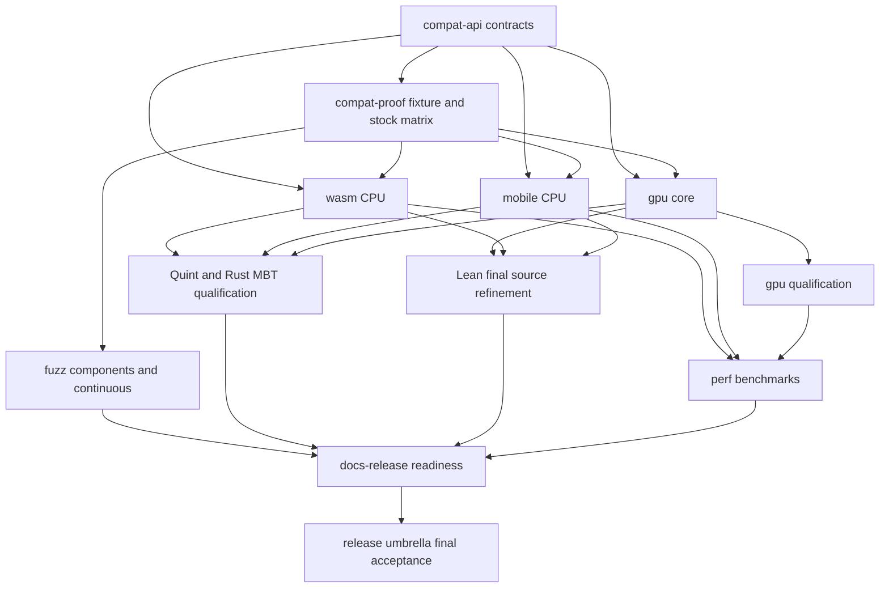

# Loki v1.0.0 roadmap

## Status

**M0 contract freeze: planning complete** — R3, 2026-10-25. Fourteen changes / 133 requirements pass strict validation; all ten authors ACKed R2 and R3, and all twenty author/scout DONE posts are recorded below. The reported planning review findings are resolved. M1–M6 implementation and qualification remain pending. Package/publication identity remains an open owner decision. This roadmap does not claim implementation or release acceptance. Baseline inspected: Loki `eaf09d8302b66b87983a5cce6a165b6756dbca58`. Documentation contains older evidence pins; they are historical, not current qualification.

## Release contract

Stock `midnight-proofs` 0.8.3 is the compatibility oracle. Preserve every public item, signature, trait, feature and default behavior; mechanically check the API superset and `[patch.crates-io]` consumers. Preserve Rust 1.76/edition 2021 contract. Proofs, VKs, existing PK representations, transcripts and challenges must interoperate in both directions. All Loki-only behavior remains explicitly opt-in. Stock limitations, including mixed committed/plain multiproof rejection, remain visible compatibility cases, not invitations to change the default protocol.

`v1.0.0` names the Loki project release. The required patch artifact retains package `midnight-proofs` version `0.8.3`, including exact-version consumers. The project cannot upload a replacement for an existing crates.io name/version. Package/publication identity remains an open owner decision; the compatible artifact is a release constraint, not evidence of an owner selection. Any separately publishable registry identity requires an owner decision and is additional to, not a substitute for, the compatible git/path artifact. Sources: `Cargo.toml:13`, `README.md:81`, `README.md:92`.

First-class targets are native CPU; `wasm32-unknown-unknown` in browser and Node, single-thread and opt-in threads; iOS device `aarch64-apple-ios` and simulator `aarch64-apple-ios-sim`; Android `aarch64-linux-android`. Compilation alone never satisfies runtime compatibility. Platform gates execute stock 0.8.3 and Loki on target and also exchange portable fixtures with native. Target support includes a measured workload envelope, numeric resource budgets, CI, limits and an explicit acceleration path.

Every shipped feature has named differential fuzz, Quint/real-Rust MBT, Lean and documentation coverage, with a reviewed reason where a particular method is inapplicable. No `sorry`, `admit`, `sorryAx`, or new custom axioms enter the release Lean project. External assumptions are explicitly inventoried; conditional model theorems do not claim machine-checked Rust equivalence. All evidence binds to the exact source manifest.

## Owners and change registry

Each Luna N owns its area, paired with Haiku N. The registry below equals the fourteen active `v1-*` changes on disk; archive directories are excluded.

| Area | Owner / reviewer | Change IDs | Acceptance responsibility |
|---|---|---|---|
| compat-api | luna-v1-1 / haiku-v1-1 | `v1-compat-api-contract` | API, default features, MSRV, downstream patch resolution |
| compat-proof | luna-v1-2 / haiku-v1-2 | `v1-compat-proof-wire-matrix`, `v1-compat-proof-stock-matrix` | Portable fixtures, stock wire oracle, supported shapes and negative controls |
| wasm | luna-v1-3 / haiku-v1-3 | `v1-wasm-cpu` | Browser/Node single/thread runtime compatibility and budgets |
| mobile | luna-v1-4 / haiku-v1-4 | `v1-mobile-cpu-compat` | iOS/Android CPU runtime compatibility, device budgets and thermal evidence |
| gpu | luna-v1-5 / haiku-v1-5 | `v1-gpu-core`, `v1-gpu-qualification` | P3/P4/P5/P7, opt-in CUDA isolation, native receipts |
| fuzz | luna-v1-6 / haiku-v1-6 | `v1-fuzz-components`, `v1-fuzz-continuous` | Structured differential coverage, campaigns, triage |
| quint | luna-v1-7 / haiku-v1-7 | `v1-quint-model-coverage` | Safety/witness/liveness contracts and actual Rust replay |
| lean | luna-v1-8 / haiku-v1-8 | `v1-lean-component-refinement` | Component coverage, proof closure and release-source correspondence |
| perf | luna-v1-9 / haiku-v1-9 | `v1-perf-benchmarks` | Complete-chain head-to-head results and regression methodology |
| docs-release | luna-v1-10 / haiku-v1-10 | `v1-docs-release-readiness` | Documentation, security/provenance, reproducible distribution and CI |
| release | astra-v1 / coordinator | `v1-release-umbrella` | Completeness, milestone promotion and final evidence manifest |

## Scope decisions

| In scope | Reason / exit evidence |
|---|---|
| API/default/drop-in compatibility, including mechanical feature/cfg checks | Non-negotiable replacement contract; stock 0.8.3 baseline plus independent consumers |
| Bidirectional proof/key/transcript interoperability and stock 0.8.1 supplemental matrix | Primary compatibility requirement and T03/T04 closure; supported/stock-rejected rows separately asserted |
| WASM browser/Node CPU, single and threads | First-class owner requirement; on-target compatibility plus numeric memory/size/time budgets |
| iOS/Android CPU, emulator and physical-device evidence | First-class owner requirement; physical memory/thermal evidence cannot be inferred from emulator success |
| CUDA P3 SRS, P4 NTT, P5 quotient/W10, P7 one-heavy chain | Complete integrated acceleration path; stock compatibility, native NVIDIA Compute Sanitizer and full-chain measurements |
| Existing CPU improvements, W13 and public opt-in features | Already shipped surfaces require qualification, source traceability and realistic performance evidence |
| Structured fuzz, continuous CPU campaigns, Quint invariants/witnesses/MBT and conditional liveness proof | Arithmetic and stateful failure paths need separate, complementary checks |
| Lean component spec, gpu-spec integration, release drift and proof-hole closure | Required formal release quality; explicitly retain model/external trust boundaries |
| README/architecture/modules/rustdoc/GPU/platform/identity docs, security and supply-chain review | Claims must match qualification and every feature needs a usable documented contract |
| Published stock-vs-Loki complete Sherlock leaf-parent-decider table | Owner closing condition; kernel or isolated phase gains are insufficient |

| Out of initial v1 scope | Reason / re-entry rule |
|---|---|
| Intel SYCL, AMD HIP, Apple Metal, Android Vulkan, WebGPU/WGSL acceleration | No qualified implementation/hardware evidence; preserve CPU target support and document backend paths |
| P6 balanced MSM, P8 lookup GPU preparation, P9 concurrent-heavy batching | Conditional optimizations expand arithmetic/scheduling proof surface; profiling may justify a separately reviewed change after v1 |
| Multi-GPU scheduling and universal CUDA/toolkit support | Finite named qualification matrix first; do not infer support from one card |
| Fused k15 terminal / Track B / new keys | Protocol/product decision and changed key identity conflict with unchanged replacement scope |
| Digest-keyed replacement of exact-coordinate SRS identity | Existing exact-prefix comparison suffices; cryptographic identity assumptions require separate design |
| New public JS package or C/UniFFI ABI | Fixture/embedding harnesses suffice for target qualification; public binding ownership/lifetime contracts need separate design |
| WASM memory64 and arbitrary large-chain phone/browser proving | v1 supports a measured 32-bit workload envelope, not unbounded device resources |
| Novelty/priority claims and external OSS-Fuzz enrollment | Not required for compatibility or correctness; avoid claims without evidence and retain in-repo continuous fuzzing |
| W12 downstream A3 fast-path adoption | Moriarty branch loki/w12-a3-residual is outside Loki; keep measured branch evidence, require explicit downstream integration and cache-contract qualification before adoption |

Re-entry requires an explicit roadmap revision, owning change, stock compatibility gates and fuzz/Quint/Lean/docs rows. A measured optimization trigger alone does not expand v1 scope.


## Existing feature and baseline qualification ledger

All listed Loki features remain default-off. “Execution” means stock field results and compatible proofs, not a claim that unrelated randomized lookup maps produce identical bytes. Each row also consumes the common fuzz/Quint/Lean/docs coverage audit.

| Feature | Behavior class / wire policy | Owner and stock oracle |
|---|---|---|
| `cuda` | Legacy execution acceleration; compatible proofs and arithmetic equality | GPU qualification; CPU/naive MSM plus stock W2 |
| `cuda-ntt` | Legacy execution acceleration; identical transform elements/order | GPU qualification; CPU/naive NTT plus stock W2 |
| `cuda-srs-registry` | Legacy exact-prefix cache, no protocol change | GPU core/qualification + Lean; prefix/mutation tests and stock W2 |
| `loki-sppark` | Legacy backend dispatch; mutually exclusive with new GPU backend | GPU qualification + Quint; real routing replay and stock W2 |
| `loki-gpu-backend` | New opt-in P3/P4/P5/P7; fixed-order output equality | GPU core/qualification; native operation equality and bidirectional stock W2 |
| `loki-backend-api` | Additive API and CPU dispatch | compat-api + Quint; API superset and default/CPU equivalence |
| `loki-profile` | Instrumentation; no protocol changes; unsupported WASM until portable | perf + compat-api + WASM; feature isolation, target diagnostics, stock W2 |
| `loki-multiopen` | Execution optimization | compat-api/proof + perf; controlled stock comparison and full proof acceptance |
| `loki-cpu-budget` | Execution/thread budget policy | compat-api/proof + perf; 1/2/max-worker controlled comparison and stock W2 |
| `loki-harden` | Opt-in failure semantics for malformed domains/rotations | compat-api + fuzz; valid stock results, explicit malformed-input differences |
| `loki-deterministic-lookup-order` | Wire-divergent ordering, no default change | compat-proof + Quint + Lean; stock acceptance, no unconditional stock-byte identity claim |

Default-on textual changes also require an inventory and stock comparison: permutation (`src/plonk/permutation/prover.rs:107`), lookup products/order (`src/plonk/lookup/prover.rs:198`), rational inversion (`src/poly/mod.rs:298`), domain/FFT dispatch (`src/poly/domain.rs:267`) and prefix products (`src/utils/arithmetic.rs:171`). compat-api owns inventory and worker-count coverage; compat-proof owns controlled-order bytes/transcript and bidirectional acceptance. An un-gated textual optimization may remain only if it preserves stock observable behavior.

P2 is a landed prerequisite, not an unmerged branch: standalone loki-gpu main has commits reported as `eb27233` / `09fd92a` by the GPU scout; the final release must record the actual integrated subtree revision and qualify it, not treat those historical pins as current receipts. Initial CUDA evidence is RTX 5090/sm_120, CUDA 13.4.3, WSL2 (`docs/GPU.md:18`); other hardware/toolkits remain unqualified until explicit receipts. Scratchpad/branch-only native receipt scripts in `deps.yaml` must become repository-owned reproducible scripts before M3 qualification.

Formal baseline reconciliation is owned by Lean: main `SYNCED-LOKI-COMMIT` is `a256a9a`, gpu-spec is `877114d`, inspected Loki is `eaf09d8`. Scout-reported drift against eaf09d8 found 81 CHANGED, 143 MOVED and 597 OK citations; these are reported diagnostic counts, not a repeated supervisor proof run. M4 requires review of every changed/moved/guessed citation. The canonical rule is `LOKI_RELEASE_SHA` from the immutable release manifest = merged Lean `SYNCED-LOKI-COMMIT` = the Loki revision selected by `MAIN_REV`/release drift. The stock oracle keeps its separate immutable pin. Updating a pin alone does not qualify anything: every retained main/GPU citation, full build, coverage inventory and no-hole/axiom audit must be reconciled and rerun against that same release SHA. gpu-spec contains proof holes at `LokiLean/BackendMsm.lean:282` (deferred P6) and `LokiLean/BackendQuotient.lean:182` (required P5), with compiler lowering open at `:387`. P5 input/safety/lowering obligations block shipping; P6 research exclusion must split/extract unfinished segmented-only source from the entire release bundle while retaining non-segmented BackendMsm/P3 contracts, an explicit deferral record and all shipped-feature coverage.

## Milestones and exit gates

| Milestone | Deliverables and exit gates |
|---|---|
| M0 — contract freeze | Strict-valid planning artifacts; all ten author ACKs; all twenty author/scout DONEs; exhaustive TODO/branch registry; specified fixture schema, valid feature/target matrix contracts and deterministic runner/budget freeze procedures; package identity recorded as an open owner decision. Concrete runners and measured budgets remain later milestone gates. Planning completion does not imply later milestones passed. |
| M1 — stock oracle and reproducible CPU baseline | Mechanical API/feature checks against pinned stock 0.8.3; Rust 1.76 consumers with `=0.8.3` and `^0.8`; bidirectional supported proof/key/transcript matrix and expected stock-rejection rows; independent stock 0.8.1/k20 evidence; clean locked workspace builds and fixtures; no unresolved default drift; valid docs.rs/rustdoc feature sets replace conflicting all-features configuration. |
| M2 — first-class target baseline | Browser/Node single+thread lanes, iOS device/simulator and Android runtime stock gates; CPU-only dependency audit; deterministic fixture replay; named physical-device memory/thermal observations; numeric memory/size/time budgets frozen from recorded baselines before qualification; named BLST native/WASM and SIMD/Rayon measurements plus target-neutral chain workload evidence (T80/T89). Missing runners or missing budgets fail this milestone. |
| M3 — integrated CUDA and stateful paths | P4→P3 and W10→P5 integration plus P7; MERGE-CPU after each merge; native receipts on integrated SHA; P3/P4/P5 arithmetic equality, positive GPU dispatch, cancellation-no-retry, complete host fallback, memory budget and lifetime fault injection; full chain stock-accepted. |
| M4 — complete QA and formal closure | Required CPU ASan campaigns clean: at least three enumerated positive/negative/boundary cases per target and all six soundness mutation classes; weekly ≥600 seconds/target and RC ≥600 seconds/target with soundness ≥1800 seconds (weekly cap 7200 CPU-seconds and separate RC cap 8400 for at most 12 targets); no untriaged/security-blocking findings; all shipped stateful paths have invariant+witness+real Rust MBT; T29 temporal liveness under explicit fairness; Lean full build, no holes/new custom axioms, exact-release citations, closed shipped-feature obligations with explicit external assumptions; complete feature coverage ledger. |
| M5 — performance and release candidate | Repeated matched complete-chain stock/Loki trials with independent stock verification, fixed features/workers/hardware, sample counts/dispersion, all CPU phases and raw artifacts; target budgets pass; docs/security/provenance/license/SBOM/audit complete, including SECURITY.md, deployment threat model and T08 timing review; supported native regression policy passes; canonical benchmark table published at `/home/charles/repos/Moriarty-factory/wiki-llm/loki/benchmark/RESULTS.md` with checked Loki `docs/benchmarks/RESULTS.md` mirror. |
| M6 — v1.0.0 qualification | All area acceptance gates green against one immutable source manifest, no open blockers, final strict validation, review of docs versus measured support, clean consumer installation and release rollback instructions, owner approval of release publication. Any code/dependency change invalidates affected evidence and requires rerun. |

## Dependency DAG and interfaces

The area DAG describes qualification inputs, not an instruction to delay authoring. QA and documentation design proceed in parallel from M0; their final evidence consumes the integrated implementation. This avoids artificial cycles between implementers and reviewers.



Exact change edges: `v1-compat-api-contract` feeds all other acceptance gates. `v1-compat-proof-stock-matrix` consumes `v1-compat-proof-wire-matrix`; the latter consumes the API contract and defines fixture/schema ownership for WASM, mobile, GPU, fuzz and performance. `v1-gpu-qualification` consumes `v1-gpu-core`; `v1-fuzz-continuous` consumes `v1-fuzz-components`. `v1-quint-model-coverage` and `v1-lean-component-refinement` consume the release implementation manifest, including target and GPU changes. CPU fake-driver replay qualifies only actual Rust dispatcher/host policy; device arithmetic and asynchronous lifetime require separate GPU evidence. `v1-perf-benchmarks` consumes qualified CPU/target/GPU artifacts. `v1-docs-release-readiness` consumes every area's evidence; `v1-release-umbrella` consumes every registered change. These evidence edges do not prohibit earlier implementation of infrastructure.

Branch integration order from `deps.yaml:11`: P4 precedes P3; P4+P3+W10 precede P5; P4 precedes P7 code merge. P7 full-chain acceptance additionally waits for P5. The older conceptual prerequisites in `loki-gpu/design/PLAN.md:25` do not replace the current executable train order: P2 is already baseline, while P4 runtime API changes explain P3/P7 test-port ordering. GPU repository changes merge there before Loki subtree integration. `docs/MERGE-GATES.md:8` defines MERGE-CPU; `:9` defines native receipts. A native failure blocks release/push, even when the code was correctly allowed to merge earlier.

Interface owners:

- compat-api: default/feature/target API inventory and valid combinations; opt-in GPU and threading boundaries.
- compat-proof: versioned portable fixture schema, source/checksum pins, deterministic controls, supported and expected-rejected shapes, shared PK/API representation policy.
- WASM/mobile: target runtime adapters, workload envelopes and measured budgets; perf supplies measurement method; GPU supplies explicit absent/opt-in capability behavior.
- fuzz: structured corpora and minimized regressions; Quint: generated trace cases and source-to-action map; Lean: named conditional contracts and source citations. Feature owners must provide seams to replay their actual shipped code.
- docs-release: immutable release manifest linking Loki, GPU subtree, Lean, stock package checksum, fixtures, toolchains, target matrices and evidence. Separate source commit and evidence commit avoid circular self-hashing.

## Risk register

| Risk | Impact | Owner | Mitigation / blocking gate |
|---|---|---|---|
| Default/API drift, package semver mismatch | Existing consumers break | compat-api + docs-release | Exact/caret patch fixtures and mechanical matrix at M1; compatible artifact never replaced by registry rename |
| Stock inherited unsupported shapes or lookup nondeterminism | False byte-equality claims or incompatible fixes | compat-proof | Separate acceptance from fixed-RNG byte assertions; expected stock-rejection rows; M1 |
| BLST/Rayon/getrandom/toolchain limitations on WASM/mobile | Required targets cannot run | wasm/mobile | Early compile/runtime probes and independent stock build; M2 blocks release |
| Runner availability and unrealistically large client circuits | Unknown budgets or untestable support | platform + perf | Freeze named runners and small admissible fixtures; no arbitrary-device claims; M2 |
| Shared GPU call sites and stale receipts after merges | Integration failures hidden by branch evidence | gpu | DAG-aware train, fake-driver checks, rerun native at merged SHA; M3 |
| Quotient memory, host fallback and cancellation bugs | Wrong result or memory corruption | gpu + Quint | Live-buffer derivation, checkpoint/no-retry invariants and fault injection; M3/M4 |
| Open Lean bridge obligations and GPU proof holes | Formal release requirement unmet | lean | Start proof closure early; explicit assumptions and source coverage; no holes/new axioms; M4 |
| Models pass while actual Rust differs | False assurance | Quint + feature owners | Mandatory current-source replay, mutation tests and coverage completeness; M4 |
| Short fuzz inputs and shared upstream vulnerabilities | Missed invalid-proof acceptance | fuzz + security | Structured coverage minima, sanitizer campaigns and release-blocking triage; M4 |
| Single-sample/phase-only historical performance | Unsupported speed claim | perf | Matched repeated full-chain data and stable artifact publication; M5 |
| Provenance/security or missing raw evidence | Unreleasable distribution or overclaims | docs-release | T08/T39/T41 review; immutable links and honest unavailable labels; M5 |

## Critical path and estimate

Estimated implementation schedule, not measured delivery promises: M0 planning lab within approximately three hours; M1 1–3 weeks; M2 3–6 weeks; M3 3–6 weeks; M4 formal/QA closure 6–12+ weeks; M5–M6 2–3 weeks after integrated qualification. With platform, GPU, QA and documentation work proceeding in parallel, an initial calendar estimate is 12–20+ weeks with at least one sustained owner for each active workstream and available Apple/Android/browser/CUDA runners. Proof obligations and unsupported dependency/toolchain paths have no defensible hard upper bound. Re-estimate after M1/M2 probes and the first formal obligation review.

Critical path is contract/fixture freeze → target feasibility and GPU integration → actual-source MBT and Lean closure → complete-chain/native qualification → immutable release evidence. Formal closure is the likely dominant uncertainty; hardware availability can instead make M2/M3 dominant. Native lock contention is mitigated by CPU merge gates, not by dropping native release evidence.

## TODO disposition ledger

Every item remains open until its owning implementation acceptance gate produces evidence. “Deferred” does not mark TODO complete. Source lines refer to the inspected baseline TODO.md. Each row is individually mapped so additions/removals can be detected mechanically.

| Item / source | Work | Owning change(s) | Disposition / reason |
|---|---|---|---|
| T01 (`TODO.md:7`) | Publish canonical checkout URLs and revision policy | `v1-docs-release-readiness` | Required: canonical URLs/revisions |
| T02 (`TODO.md:11`) | Validate a minimal downstream consumer | `v1-compat-api-contract`, `v1-compat-proof-wire-matrix` | Required: clean patched consumer plus stock-verified CPU proof |
| T03 (`TODO.md:15`) | Publish and enforce the supported instance/batch matrix | `v1-compat-proof-wire-matrix`, `v1-quint-model-coverage` | Required: stock-supported/rejected matrix |
| T04 (`TODO.md:19`) | Complete the additional G2 verifier cases | `v1-compat-proof-stock-matrix` | Required: 0.8.1 and k20 evidence |
| T05 (`TODO.md:23`) | Establish exact-target novelty priority, if claimed | `v1-docs-release-readiness` | Deferred: no novelty-priority claim in v1 |
| T06 (`TODO.md:27`) | Measure complete recursion-chain performance | `v1-perf-benchmarks` | Required: complete-chain matched trials |
| T07 (`TODO.md:31`) | Derive the quotient memory budget | `v1-gpu-core` | Required: live-buffer memory derivation |
| T08 (`TODO.md:35`) | Review witness-dependent timing in rational inversion | `v1-docs-release-readiness` | Required: deployment-specific timing review |
| T09 (`TODO.md:39`) | Synchronize the Lean source pin with current Loki | `v1-lean-component-refinement` | Required: release source pin |
| T10 (`TODO.md:43`) | Close stock-trace-faithful | `v1-lean-component-refinement` | Required: abstract stock refinement; full Rust-to-event extraction may remain an explicitly inventoried external correspondence assumption with owner review and compatibility evidence. Formal bridge deferred if unproved; no Rust-equivalence claim |
| T11 (`TODO.md:47`) | Close quot-inputs | `v1-lean-component-refinement` | Required: named obligation discharge/review for shipped paths; explicit external assumptions cannot imply proved Rust correspondence |
| T12 (`TODO.md:51`) | Establish stock-complete-any-order | `v1-lean-component-refinement` | Required: named obligation discharge/review for shipped paths; explicit external assumptions cannot imply proved Rust correspondence |
| T13 (`TODO.md:55`) | Discharge keygen-deterministic | `v1-lean-component-refinement` | Conditional on shipped PK-cache code: required if present; otherwise explicitly defer with release-source inventory. The modeled recl9 cache and deferred W12 adoption do not establish Loki package inclusion |
| T14 (`TODO.md:59`) | Prove shipped exact-prefix registry refinement | `v1-lean-component-refinement` | Required: exact-prefix registry refinement for shipped opt-in cuda-srs-registry; not default behavior |
| T15 (`TODO.md:63`) | Prove msm-segmented-partition | `v1-lean-component-refinement` | Deferred with P6: split/extract segmented-only declarations and their hole-dependent closure from the release source/library or prove them; retain nonsegmented BackendMsm/P3 contracts; global no-hole rule unchanged |
| T16 (`TODO.md:67`) | Prove quotient-interpreter-safety | `v1-lean-component-refinement` | Required: named obligation discharge/review for shipped paths; explicit external assumptions cannot imply proved Rust correspondence |
| T17 (`TODO.md:71`) | Prove quotient-compiler-lowering | `v1-lean-component-refinement` | Required: named obligation discharge/review for shipped paths; explicit external assumptions cannot imply proved Rust correspondence |
| T18 (`TODO.md:75`) | Relate P2 runtime code to its Lean transition model | `v1-lean-component-refinement` | Required: abstract P2 transition contracts, actual-source Quint replay and T19 lifetime evidence. Any unproved Rust/runtime extraction remains a named external correspondence assumption and formal deferral, never a proved fact |
| T19 (`TODO.md:79`) | Close runtime-lifetime evidence | `v1-gpu-qualification` | Required: native lifetime fault/sanitizer evidence |
| T20 (`TODO.md:83`) | Specify digest-binds and disk integrity | `v1-lean-component-refinement`, `v1-quint-model-coverage` | Conditional on shipped cache code: require identity/integrity contract and explicit assumptions if present; otherwise defer with release-source inventory. W12/recl9 inclusion is not assumed |
| T21 (`TODO.md:87`) | Resolve future digest-keyed SRS identity | `v1-gpu-core` | Deferred: retain exact-coordinate identity |
| T22 (`TODO.md:91`) | Complete P3 legacy adapter and SRS integration | `v1-gpu-core` | Required: P3 |
| T23 (`TODO.md:95`) | Complete P4 resident NTT/coset pipeline | `v1-gpu-core` | Required: P4 |
| T24 (`TODO.md:99`) | Complete P5 quotient compiler and interpreter integration | `v1-gpu-core`, `v1-lean-component-refinement` | Required: P5 plus input/lowering closure |
| T25 (`TODO.md:103`) | Decide and implement P6 balanced MSM | `v1-gpu-core` | Deferred: P6 conditional optimization; record profile-based decision |
| T26 (`TODO.md:107`) | Implement P7 chain integration and scheduling | `v1-gpu-core`, `v1-quint-model-coverage` | Required: P7 single-heavy chain |
| T27 (`TODO.md:111`) | Decide P8/P9 lookup batching and concurrency | `v1-gpu-core` | Deferred: P8/P9 conditional optimizations |
| T28 (`TODO.md:115`) | Define cancellation before scheduling uses it | `v1-gpu-core`, `v1-quint-model-coverage` | Required: cancellation never CPU-retried |
| T29 (`TODO.md:119`) | Prove scheduler liveness | `v1-quint-model-coverage` | Required: temporal liveness with explicit fairness |
| T30 (`TODO.md:123`) | Expand transcript replay fixtures | `v1-quint-model-coverage` | Required: expanded transcript fixtures |
| T31 (`TODO.md:127`) | Replay current dispatch/NTT implementation | `v1-quint-model-coverage` | Required: current-source dispatch/NTT replay |
| T32 (`TODO.md:131`) | Improve proof and soundness fuzz input coverage | `v1-fuzz-components` | Required: structured generators and coverage |
| T33 (`TODO.md:135`) | Document key-cache retention and caller assumptions | `v1-quint-model-coverage`, `v1-docs-release-readiness` | Conditional on release-source inventory: require retention/caller assumptions for shipped cache code; otherwise record explicit deferral |
| T34 (`TODO.md:139`) | Measure W13 on production chain shapes | `v1-perf-benchmarks` | Required: W13 production-chain measurements |
| T35 (`TODO.md:143`) | Validate multi-device and additional hardware behavior | `v1-gpu-qualification` | Required: named supported CUDA matrix; multi-device and broader hardware deferred |
| T36 (`TODO.md:147`) | Integrate W10 with P1/W13 | `v1-gpu-core` | Required: W10/P1/W13 integration |
| T37 (`TODO.md:151`) | Validate the declared Rust minimum | `v1-compat-api-contract` | Required and currently unmet: preserve 1.76; current root lock selects newer-MSRV dependencies; dedicated compatible lock/build evidence, no silent raise |
| T38 (`TODO.md:155`) | Repair standalone locked-workspace reproducibility | `v1-docs-release-readiness`, `v1-fuzz-continuous` | Required: locked workspace policy/reproduction |
| T39 (`TODO.md:159`) | Audit backend provenance and attribution | `v1-docs-release-readiness` | Required: clean-room provenance and attribution |
| T40 (`TODO.md:163`) | Complete narrower formal/runtime novelty comparison | `v1-docs-release-readiness` | Deferred: no formal/runtime priority claim |
| T41 (`TODO.md:167`) | Validate complete historical performance evidence portability | `v1-perf-benchmarks`, `v1-docs-release-readiness` | Required: portable raw evidence or explicit historical unavailability |
| T42 (`TODO.md:171`) | Decide fused k15 terminal proposal | `v1-docs-release-readiness` | Deferred: reject Track B from unchanged-key v1 scope |
| T43 (`TODO.md:175`) | Intel: Detect Intel GPUs through Level Zero; fill `BackendCapabilities`. | `v1-gpu-qualification` | Deferred: Intel backend outside initial v1 |
| T44 (`TODO.md:179`) | Intel: 32-bit-limb Fr and Fp Montgomery mul, add, sub in SYCL; G1. | `v1-gpu-qualification` | Deferred: Intel backend outside initial v1 |
| T45 (`TODO.md:183`) | Intel: Microbenchmark 32-bit vs 64-bit limb throughput; record numbers in this file. | `v1-gpu-qualification` | Deferred: Intel backend outside initial v1 |
| T46 (`TODO.md:187`) | Intel: NTT, natural-order output, up to the CUDA-equal `max_transform_log`; G1, G2. | `v1-gpu-qualification` | Deferred: Intel backend outside initial v1 |
| T47 (`TODO.md:191`) | Intel: MSM with the same digit and bucket scheme as `MSM.md`; G1, G2, G5. | `v1-gpu-qualification` | Deferred: Intel backend outside initial v1 |
| T48 (`TODO.md:195`) | Intel: Resident buffers, SRS lease path; G4. | `v1-gpu-qualification` | Deferred: Intel backend outside initial v1 |
| T49 (`TODO.md:199`) | Intel: Quotient interpreter; G2. | `v1-gpu-qualification` | Deferred: Intel backend outside initial v1 |
| T50 (`TODO.md:203`) | Intel: Stock-verifier run on a real k17 to k19 proof; G3. | `v1-gpu-qualification` | Deferred: Intel backend outside initial v1 |
| T51 (`TODO.md:207`) | Intel: Chain run on Arc and on a Max card, if available; G6. | `v1-gpu-qualification` | Deferred: Intel backend outside initial v1 |
| T52 (`TODO.md:211`) | AMD: Run hipify-clang over a copy of `cuda/`; record what fails to compile. | `v1-gpu-qualification` | Deferred: AMD backend outside initial v1 |
| T53 (`TODO.md:215`) | AMD: Replace PTX asm with portable primitives; G1. | `v1-gpu-qualification` | Deferred: AMD backend outside initial v1 |
| T54 (`TODO.md:219`) | AMD: Parameterise wavefront size (32 and 64); test both on RDNA. | `v1-gpu-qualification` | Deferred: AMD backend outside initial v1 |
| T55 (`TODO.md:223`) | AMD: NTT and MSM parity: G1, G2, G5. | `v1-gpu-qualification` | Deferred: AMD backend outside initial v1 |
| T56 (`TODO.md:227`) | AMD: SRS lease, error mapping (HIP error codes to `ErrorKind`); G4. | `v1-gpu-qualification` | Deferred: AMD backend outside initial v1 |
| T57 (`TODO.md:231`) | AMD: Stock verifier; G3. | `v1-gpu-qualification` | Deferred: AMD backend outside initial v1 |
| T58 (`TODO.md:235`) | AMD: Chain run on one CDNA and one RDNA card; G6. | `v1-gpu-qualification` | Deferred: AMD backend outside initial v1 |
| T59 (`TODO.md:239`) | Apple: Metal device discovery; `recommendedMaxWorkingSetSize` into `device_memory_budget`. | `v1-gpu-qualification` | Deferred: Apple GPU backend outside initial v1 |
| T60 (`TODO.md:243`) | Apple: Decide the unified-memory capability in the API (O1) before writing buffers. | `v1-gpu-qualification` | Deferred: Apple GPU backend outside initial v1 |
| T61 (`TODO.md:247`) | Apple: 32-bit-limb Fr/Fp Montgomery in MSL; G1. | `v1-gpu-qualification` | Deferred: Apple GPU backend outside initial v1 |
| T62 (`TODO.md:251`) | Apple: 32 vs 64-bit limb microbenchmark on M-series; record here. | `v1-gpu-qualification` | Deferred: Apple GPU backend outside initial v1 |
| T63 (`TODO.md:255`) | Apple: NTT, then MSM (sort-based buckets); G1, G2, G5. | `v1-gpu-qualification` | Deferred: Apple GPU backend outside initial v1 |
| T64 (`TODO.md:259`) | Apple: Quotient interpreter; G2. | `v1-gpu-qualification` | Deferred: Apple GPU backend outside initial v1 |
| T65 (`TODO.md:263`) | Apple: Stock verifier; G3. Chain run on the largest-memory M-series Mac available; G6. | `v1-gpu-qualification` | Deferred: Apple GPU backend outside initial v1 |
| T66 (`TODO.md:267`) | Apple: Thermal behaviour on fanless parts (MacBook Air) documented. | `v1-gpu-qualification` | Deferred: Apple GPU backend outside initial v1 |
| T67 (`TODO.md:271`) | Mobile phones: Measure the smallest Loki leaf proof on a mid-range phone on CPU only (aarch64 build). This is the real baseline. | `v1-mobile-cpu-compat` | Required: physical-phone CPU baseline |
| T68 (`TODO.md:275`) | Mobile phones: Decide which circuits are client-side candidates (O8). | `v1-mobile-cpu-compat` | Required: freeze client workload/data boundary |
| T69 (`TODO.md:279`) | Mobile phones: iOS: reuse the Metal backend; run G1 to G3 on an iPhone. | `v1-mobile-cpu-compat` | Deferred: Metal arithmetic; CPU iOS remains mandatory |
| T70 (`TODO.md:283`) | Mobile phones: Android: Vulkan `shaderInt64` survey across Adreno and Mali; 32-bit-limb kernels; G1 to G3. | `v1-mobile-cpu-compat` | Deferred: Vulkan arithmetic/capability survey |
| T71 (`TODO.md:287`) | Mobile phones: Thermal soak test: 10 consecutive proofs, record per-proof time; G6 reported as sustained throughput. | `v1-mobile-cpu-compat` | Required: ten-proof physical thermal soak |
| T72 (`TODO.md:291`) | Mobile phones: Memory-kill test: confirm clean `ContextLost` handling; G4. | `v1-mobile-cpu-compat` | Required: CPU process/OOM artifact integrity; GPU ContextLost path deferred |
| T73 (`TODO.md:295`) | WebAssembly: Audit workspace crates for `wasm32-unknown-unknown` compilation (BLST, rayon, getrandom, std::time). | `v1-wasm-cpu` | Required: target dependency audit |
| T74 (`TODO.md:299`) | WebAssembly: CPU build in a browser; prove the smallest circuit; G3 using the stock verifier compiled to wasm or run natively on the produced bytes. | `v1-wasm-cpu`, `v1-compat-proof-wire-matrix` | Required: on-target stock and Loki gate plus native exchange |
| T75 (`TODO.md:303`) | WebAssembly: Add `wasm-bindgen-rayon`; measure scaling to 4, 8, 16 workers. | `v1-wasm-cpu` | Required: threads runtime/scaling evidence; unsupported worker counts recorded |
| T76 (`TODO.md:307`) | WebAssembly: Measure the memory ceiling: largest k that proves in Chrome, Firefox and Safari. | `v1-wasm-cpu` | Required: browser memory envelope |
| T77 (`TODO.md:311`) | WebAssembly: WGSL 32-bit-limb Fr/Fp Montgomery; G1. | `v1-wasm-cpu` | Deferred: WebGPU arithmetic/backend outside initial v1 |
| T78 (`TODO.md:315`) | WebAssembly: WGSL NTT, then MSM; G1, G2, G5. | `v1-wasm-cpu` | Deferred: WebGPU arithmetic/backend outside initial v1 |
| T79 (`TODO.md:319`) | WebAssembly: Worker-hosted backend, `ContextLost` mapping; G4. | `v1-wasm-cpu` | Deferred: WebGPU arithmetic/backend outside initial v1 |
| T80 (`TODO.md:323`) | WebAssembly: Chain-level comparison against CPU wasm; G6. | `v1-wasm-cpu`, `v1-perf-benchmarks` | Required: CPU WASM target-chain baseline/outcome; original WebGPU-vs-CPU comparison deferred with WebGPU |
| T81 (`TODO.md:327`) | Platform decision O1 unified-memory API | `v1-gpu-core` | Deferred: unified-memory accelerator API |
| T82 (`TODO.md:331`) | Platform decision O2 changing device budgets | `v1-gpu-core` | Deferred: dynamic device budgets; CPU envelope still required |
| T83 (`TODO.md:335`) | Platform decision O3 browser completion model | `v1-wasm-cpu` | Required: CPU worker/completion documentation; GPU async design deferred |
| T84 (`TODO.md:339`) | Platform decision O4 limb throughput | `v1-gpu-core` | Deferred: non-CUDA kernel limb benchmarking |
| T85 (`TODO.md:343`) | Platform decision O5 public platform prior art | `v1-docs-release-readiness` | Deferred: platform priority research; licensing of shipped code still required |
| T86 (`TODO.md:347`) | Platform decision O6 Android capabilities | `v1-mobile-cpu-compat` | Deferred: Android GPU capabilities |
| T87 (`TODO.md:351`) | Platform decision O7 device memory ceilings | `v1-wasm-cpu`, `v1-mobile-cpu-compat` | Required: measured CPU memory ceilings |
| T88 (`TODO.md:355`) | Platform decision O8 client-side circuits and data | `v1-mobile-cpu-compat`, `v1-wasm-cpu` | Required: client circuit/data envelope |
| T89 (`TODO.md:359`) | Platform decision O9 wasm BLST baseline | `v1-wasm-cpu`, `v1-perf-benchmarks` | Required: BLST portable WASM/native baseline; whole-Loki SIMD128 and Rayon variants measured separately |
| T90 (`TODO.md:363`) | Platform decision O10 portable/native comparison | `v1-gpu-core` | Deferred: portable/native accelerator comparison |
| T91 (`TODO.md:367`) | Platform decision O11 browser verifier gate | `v1-wasm-cpu`, `v1-compat-proof-wire-matrix` | Required: stock verifier on WASM, native additional |
| T92 (`TODO.md:371`) | Platform decision O12 kernel reuse notices | `v1-docs-release-readiness` | Required: shipped kernel attribution; future ports inherit policy |

## Unmerged branch disposition

| Work | Owning change | Disposition and dependency |
|---|---|---|
| `loki/p4-ntt` | `v1-gpu-core` | Required; first backend integration after existing P1; native NTT/coset qualification |
| `loki/p3-srs` | `v1-gpu-core` | Required after P4; port tests to fake runtime and retain exact-prefix mutation regressions |
| `loki/w10-gpu-quotient` | `v1-gpu-core` | Required input to P5; reconcile P1/W13 call sites/counters; branch-only timing is not acceptance |
| `loki/p5-quotient` | `v1-gpu-core` | Required after P4/P3/W10; input/lowering/interpreter proofs plus stock chain gates |
| `loki/p7-chain` | `v1-gpu-core` + `v1-quint-model-coverage` | Merge after P4; full-chain acceptance after P5; one-heavy scheduling, checkpoint/cancellation and temporal liveness |
| Moriarty `loki/w12-a3-residual` at `e50b775c3c7e9ebd77ec31c5337bb94d604b1957` | `v1-perf-benchmarks` + `v1-lean-component-refinement` | Deferred downstream adoption pending explicit integration and cache correctness/model coverage; benchmark its branch work separately. Source: `/home/charles/repos/loki-wt/w12-a3-residual/LOKI-A3-RESIDUAL.md:3`; the relation-bound fast path is in Moriarty, no Loki-source changes. Disk reuse is test-only and not adopted (`:19`). Existing shipped cache behavior remains subject to T13/T20/T33 |

## Decisions for the owner and release loop

The owner has not decided package/publication identity. The required stock-compatible artifact must remain available; any additional registry name/version needs explicit owner selection. The owner must also fund/name persistent platform runners, approve the measured client workload/budget envelope, and assign sustained formal proof ownership. No decision can waive stock compatibility, required CPU targets, or the no-hole/no-new-axiom gate. Accelerator scope expansions and Track B require a new change rather than a hidden release exception.

Recommended coordinator order: freeze compatible identity/fixtures/feature matrix; run M1 CPU gates; begin target probes and formal closure concurrently; integrate P4, P3 and W10, then P5 and P7 in dependency order using MERGE-CPU; collect integrated native receipts; execute target runtime and resource gates; complete fuzz, actual-source Quint replay and Lean closure; publish repeated complete-chain results; reconcile docs/security/distribution; freeze the release manifest and rerun affected checks before authorizing publication. This lab does not execute that loop.


## R3 review closure and coverage audit

The resumed supervisor checked the source anchors and final author corrections against the historical scout findings. These are closed **planning** findings; their implementation and qualification gates remain open. Historical scout DONE posts are retained as review evidence, not represented as fresh post-reboot signoffs.

| Finding | Planning resolution and owning artifact |
|---|---|
| T80/T89 missing from perf | `v1-perf-benchmarks/specs/benchmark-evidence/spec.md` now has named CPU WASM chain, portable BLST native/WASM, and separate whole-Loki SIMD128/Rayon scenarios; tasks 3.5/3.6 own delivery. Perf owns smoke configuration, compat-proof owns schema/IDs, WASM owns runtime and budgets. Required smoke passes on each lane; only larger out-of-envelope chains may be reported unsupported. |
| Unsupported host citation in perf design:23 | The invented attribution to SUITE.md was removed. Design and hardware scenario require a newly frozen runner manifest; SUITE N=4/20 methodology is not host identity evidence. Numeric native policy fails a median chain slowdown greater than 5% versus matched stock at either budget, after validity/noise qualification. |
| T15 BackendMsm split | GPU arithmetic requirement and Lean design/tasks preserve nonsegmented P3 contracts. Split/extract only segmented P6 declarations plus transitive hole dependencies from both release source and built library, or prove them. Removing the whole required module is not accepted. |
| Scheduler anchors | GPU chain scenarios cite actual `loki/p7-chain:loki-gpu/crates/loki-gpu/src/schedule.rs:31-40` and branch scheduler tests; the inspected prototype explicitly lacks reservation redemption. P2 accounting is a separate seam, and reviewed allocation ownership plus actual-source replay remain release gates. |
| Scratch native receipt scripts | GPU qualification task 2.5 requires tracked repository scripts, DAG path checks, native execution and receipts at the exact merged SHA; scratch references in `deps.yaml:15,22,28,36` do not qualify. |
| Stock-matrix differential citation | The T04 source anchor is now `loki-harness/tests/differential.rs:25-32`, within the 32-line file. It is an existing ignored determinism test, not evidence that the proposed two-fixture k20/version matrix ran. |
| k20 versus run.sh timeout | Stock-matrix spec/design/task 1.1 prescribe a new direct runner with a 1800-second hard ceiling, bypassing the existing 292-second wrapper at `loki-harness/run.sh:8`. Timeout fails; the ceiling is not a measured performance estimate. |
| 0.8.1 acquisition | Stock-matrix specifies the immutable `https://static.crates.io/crates/midnight-proofs/midnight-proofs-0.8.1.crate` URL, checksum/provenance capture and isolated locked lane; stock 0.8.3 remains the oracle. Acquisition/build/run evidence is not claimed by this lab. |
| Untested default permutation/lookup rewrites | API default-delta and wire arithmetic requirements enumerate `src/plonk/permutation/prover.rs:107` and `src/plonk/lookup/prover.rs:198`; workers 1/2/20 compare arithmetic and both proof directions. Byte equality requires controlled order/schedule; random-order differences are diagnostic. No passing source-bound artifact means NOT QUALIFIED. |
| Three Lean source pins disagree | The single manifest-SHA baseline rule now appears in roadmap/config/umbrella and Lean design/task 1.1. Fresh citation/coverage/build/trust receipts are mandatory; historical pins and changing the pin text alone cannot pass M4. |
| Remaining paired-review coherence | Mobile budget directions and proposed-path labels were corrected. Quint requires a mutation/counterexample for every invariant and reproducible offline dependencies; T29 temporal verification remains a future blocker. Lean normative wording distinguishes required abstract proofs from explicitly scoped external correspondence assumptions. |

The following mapping checks every in-scope roadmap row against an owning specification. Common feature coverage is independently enforced by the umbrella's “Shipped features have complete QA and documentation coverage,” Quint's source inventory, Lean's component inventory and docs-release's feature trace requirement. These overlapping checks consume one owner contract; they do not establish competing target thresholds or fixture schemas.

| In-scope feature group | Owning specification / named requirement coverage |
|---|---|
| API, defaults, MSRV and patch consumers | `v1-compat-api-contract/specs/compat-api/spec.md`: public API, Cargo features, stock compiler/package contracts, patch consumer and default-delta requirements |
| Proof/key/transcript and supplemental 0.8.1 | `v1-compat-proof-wire-matrix/specs/proof-interoperability/spec.md`: both proof directions, SerdeFormat, transcript, instance/batch and default rewrite requirements; `v1-compat-proof-stock-matrix/specs/stock-proof-compatibility/spec.md`: locked 0.8.1 and k20 |
| WASM CPU single/thread modes | `v1-wasm-cpu/specs/wasm-cpu/spec.md`: browser/Node, entropy, threading, on-target interoperability, resource budgets, BLST, smoke chain, unsupported-feature and documentation requirements |
| Mobile CPU devices/simulators | `v1-mobile-cpu-compat/specs/mobile-cpu-support/spec.md`: compile/runtime, physical numeric budgets, interruption integrity and client data/circuit limits |
| P3/P4/P5/P7 and retained CUDA opt-ins | `v1-gpu-core/specs/gpu-arithmetic/spec.md`, `specs/gpu-chain/spec.md`; `v1-gpu-qualification/specs/gpu-feature-policy/spec.md`, `specs/gpu-native-qualification/spec.md`: arithmetic, scheduler, feature isolation, resource and native receipt requirements |
| Existing CPU work, W13 and all public opt-ins | API default/opt-in inventory; GPU legacy feature policy; `v1-perf-benchmarks/specs/benchmark-evidence/spec.md`: CPU attribution and W13 production-shape scenario; shared QA/docs feature inventory |
| Structured and continuous differential fuzz | `v1-fuzz-components/specs/differential-fuzz-coverage/spec.md`: component/corpus/target coverage; `v1-fuzz-continuous/specs/continuous-fuzz-operations/spec.md`: campaigns, triage, sanitizer and revision-bound evidence |
| Quint and real Rust replay | `v1-quint-model-coverage/specs/quint-release-qa/spec.md`: source mapping, invariant/witness/mutation, real replay, temporal liveness and conditional cache requirements |
| Lean source refinement and proof closure | `v1-lean-component-refinement/specs/lean-component-refinement/spec.md`: component/refinement, exact-release drift, no holes/axioms, GPU merge and reproducible proof CI |
| Docs, security, provenance and distribution | All three `v1-docs-release-readiness/specs/*/spec.md` capabilities: documentation/QA trace, governance/archive/CI, T08, threat model, notices and dependency/SBOM evidence |
| Full Sherlock closing table | `v1-perf-benchmarks/specs/benchmark-evidence/spec.md`: matched inputs, complete four-stage chain, phase attribution, qualified numeric regression and publication/mirror requirements |

No unowned in-scope feature or unresolved planning overlap remains in this audit. The T80/T89 overlap uses platform-owned budgets and perf-owned measurements; compat-api inventories default deltas while compat-proof owns canonical oracle fixtures. T13/T20/T33 are conditional on actual shipped cache source, not the existence of a historical model. The complete T01–T92 and six-workstream disposition tables remain authoritative.


## Final planning evidence

R3 final audit: 2026-10-25 19:08 UTC. Fresh `openspec validate --all --strict` exited 0: **14 passed, 0 failed (14 items)**. `git diff --check` exited 0. All 133 requirements have normative language, measurable WHEN/THEN scenarios, named verification and file:line source anchors; structure was scanned mechanically and reported findings reviewed against source. The 14-change registry matches the umbrella, all 92 TODO rows are unique, and all six named workstreams have dispositions. These checks do not execute the proposed release commands.

| Change | Requirement count |
|---|---:|
| `v1-compat-api-contract` | 9 |
| `v1-compat-proof-stock-matrix` | 4 |
| `v1-compat-proof-wire-matrix` | 17 |
| `v1-docs-release-readiness` | 13 |
| `v1-fuzz-components` | 10 |
| `v1-fuzz-continuous` | 10 |
| `v1-gpu-core` | 10 |
| `v1-gpu-qualification` | 11 |
| `v1-lean-component-refinement` | 6 |
| `v1-mobile-cpu-compat` | 7 |
| `v1-perf-benchmarks` | 5 |
| `v1-quint-model-coverage` | 9 |
| `v1-release-umbrella` | 12 |
| `v1-wasm-cpu` | 10 |
| **Total** | **133** |

Durable AgentBus message IDs below are the audit trail (`agentbus --cwd ~/repos/loki-wt/ids/astra-v1 log --all`). All ten authors ACKed R2 and R3 and posted DONE; all ten scouts posted DONE before the reboot. Scout 2 delivered its review to its paired author; that durable post is included. Scout DONEs with findings are closed by the explicit R3 resolution table and resumed author/supervisor review, not by an invented new scout approval.

| Area / pair N | Author ACK R2 | Author ACK R3 | Author DONE | Scout DONE |
|---|---|---|---|---|
| 1 | `01M5T76HJJDPNBW0NCB7E8AXDS` | `01M5T77AW3RCET6X0ZN9CP9G8W` | `01M5T77AZ4VHVB7XTD0ZD8Y31B` | `01M5T5FQDC6831EQJ49YYTAZ0X` |
| 2 | `01M5T75TYGFVC8CA9AZJGP7PRA` | `01M5T777ZQQEP1YV3KFKME45RC` | `01M5T7782Z07T99W3XBRKGT38T` | `01M5T5CZ8CTQC5YW0WA621ADX2` |
| 3 | `01M5T745YK1W9MSQFN0DHP6Z65` | `01M5T774XTXK36A1EBEQWHKBJT` | `01M5T77523PHXFHQJ71BMY89NT` | `01M5T5ECTTECT37KX7BR10C8EA` |
| 4 | `01M5T73J9E8JFG7C1SJXQP39QD` | `01M5T776S0AVHK504D7YB5GQZJ` | `01M5T776XA3G8CZJA1MAXGSGD9` | `01M5T5FS7J47WHEEGME0CP3VKR` |
| 5 | `01M5T73KFJHV5S2WWP0CCHEC9C` | `01M5T774SWC1YSQDJ20QA1MRB5` | `01M5T774XQ3SKFW28QCMBVZPBQ` | `01M5T5ES31AY3A62NX3WN8JPFX` |
| 6 | `01M5T73PHXWB3ET5KT06JR2CQQ` | `01M5T774KNB368QNG716JDXSQS` | `01M5T774PG7Y3DZCH4W5B7F26X` | `01M5T5FA7J15AJ4NW7NCDN4DCK` |
| 7 | `01M5T73SK54Z12TB1RYJFP0E06` | `01M5T781MFCGVGAEKSXV5BYHNM` | `01M5T79TJ0H0WGB2WD6JZ7RDKD` | `01M5T5ERMWYY9P4TZ3KRMMWF74` |
| 8 | `01M5T74F5KAWW72ETQS2HQ10ZC` | `01M5T7765HD02XP0DYN3N1DFVF` | `01M5T78P3PCFE256SEWETC4CX7` | `01M5T5EHBZVXMV67M28DJDXR19` |
| 9 | `01M5T76GB1HTYHD0MG5HND6AQY` | `01M5T777FACAFNJAJGTSX598H0` | `01M5T77TZGN7052RZGTZJBN1CW` | `01M5T5EY4EAXGBTYWC9CTRVAQH` |
| 10 | `01M5T73TR5YB7S99RD3KCTZ6DY` | `01M5T777RSRRDQ6K0Y5EAC5SY3` | `01M5T777RSRRDQ6K0Y5EAC5SY3` | `01M5T5FF456CB207F12YPDS1MD` |

Validation output tail:

```text
✓ change/v1-perf-benchmarks
✓ change/v1-quint-model-coverage
✓ change/v1-release-umbrella
✓ change/v1-wasm-cpu
Totals: 14 passed, 0 failed (14 items)
```
